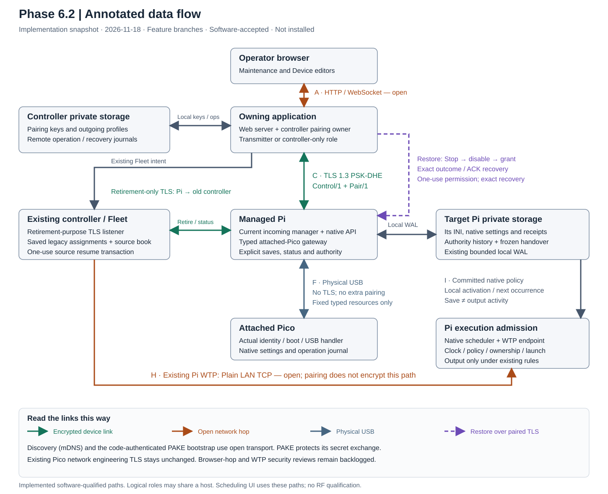
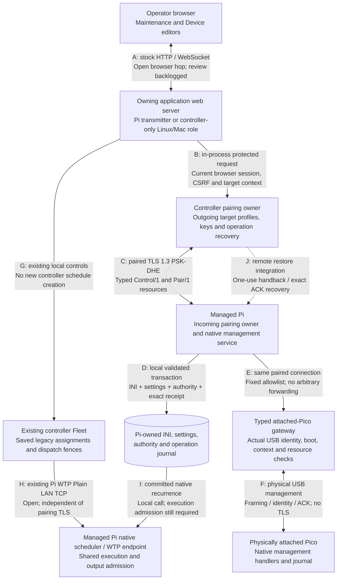
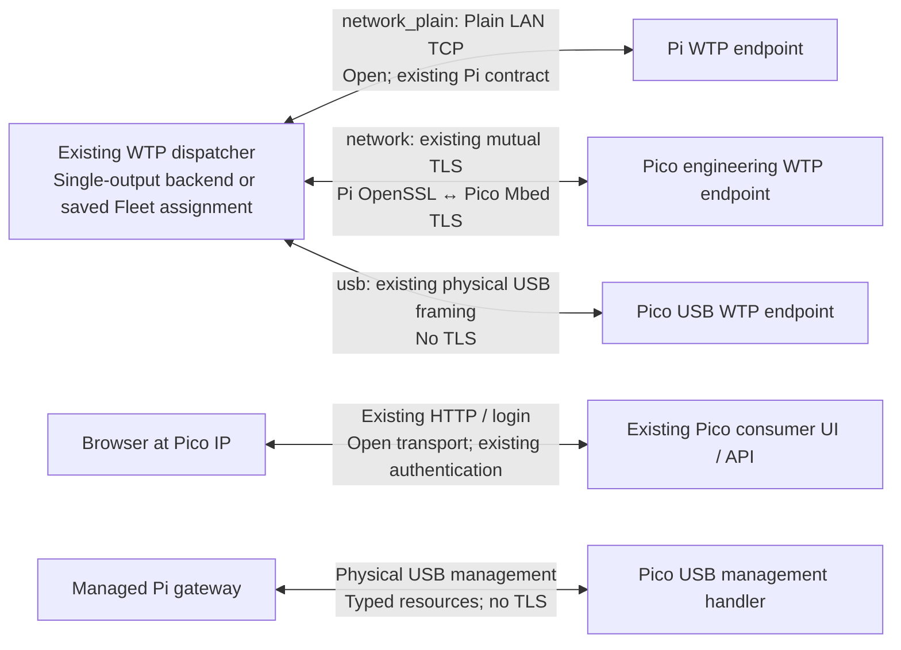

# Phase 6.2 annotated data flow

Snapshot: 2026-11-18, phase 6.2 software acceptance completed on the #473 feature branches. The [final evidence](phase-6-2-final-acceptance.json) identifies the exact tested sources and commands. Paths describe implemented mechanisms and remain subject to their current admission checks. The software fixtures do not qualify physical USB, LAN discovery, installation, services, timing or RF. Nothing is installed by this work.



## 1. System boundaries and transports



| Label | Data and boundary | Encryption and authority |
| --- | --- | --- |
| A | Browser forms, displayed pairing code, Device reads/saves, action feedback and status. | The stock browser connection is HTTP and ordinary WebSocket, not the new device-to-device TLS connection. LAN/loopback, Host, Origin, proxy-client, session and CSRF checks protect requests but do not encrypt this hop. Browser-hop security remains backlogged. |
| B | The web handler selects the real local/browser owner and current target context. | An in-process call. Browser JSON supplies intent and preconditions, not authority, keys or an arbitrary forwarding destination. |
| C | Native Pi configuration/status, attached-Pico management, rotation, authority registration and the separately bounded resume messages. | OpenSSL TLS 1.3 PSK-DHE, `wsprry-management/1`, fixed management port 31418. Pairing establishes device-owned keys; users provision no certificates or keys. Botan is PAKE-only and remains subject to final provider/maintenance/package acceptance. |
| D | Explicit validated saves and owner-controlled metadata transitions. | Local private files and the existing bounded write-ahead journal. A committed save and its receipt are one decision. This is ordinary protected local storage, not a claim of encryption at rest. |
| E–F | A selected Pico's existing typed resources through its paired parent Pi and the actual attached USB device. | The network leg is the parent's TLS connection. The physical USB leg is not TLS. Management negotiates automatically through the paired Pi without a second pairing or delegation grant. Child identity, boot and generations are checked independently. |
| G–H | Existing saved legacy schedules and WTP job/control/status traffic. | Existing Pi WTP uses Plain LAN TCP and remains open. Existing Pico engineering network WTP uses its existing mutual TLS; Pico USB WTP uses its existing physical USB carrier. New Pi pairing does not wrap or replace these transports. WTP review/TLS work remains backlogged. |
| I | The managed Pi evaluates its own committed schedule, solar policy, clock and execution/output rules. | Local execution. A management save or enable is not a network transmission job and does not bypass final launch admission. |
| J | An explicitly requested return to the selected old controller's schedule. | Uses normal paired TLS and a one-use target-issued grant. Target grant issuance, source one-use publication, acknowledgement recovery and refreshed registration pass a combined actual TLS/journal/Fleet fixture. The combined backend passes two retirement/restore cycles; Maintenance passes focused two-device browser checks. Fresh-process grant/ACK and derived-key crashes, positive retired-key reclamation, and actual protected browser migration now pass focused checks. Final source-wide software qualification passed. |

A controller-only installation still owns its private pairing, remote-operation and controller state on its own disk. Editing a managed Pi writes that target Pi's INI and journals. It does not create a transmitter INI on the controller as a substitute for the target. A transmitter installation can act as a controller as well; these logical roles do not require separate machines.

Existing direct Pico IP login and engineering management retain their existing transports and authentication. The new paired-Pi path does not silently convert those direct routes to the Pi's new pairing scheme.

### Existing WTP carriers and direct Pico access



The paired-Pi gateway carries configuration management only. It cannot become an arbitrary HTTP/USB forwarder or a WTP dispatch tunnel. WTP still owns the existing transmission job/session/ownership exchange; typed management endpoints do not silently replace that execution contract. The security backlog will review that division and whether WTP should gain TLS or otherwise change; this phase does not make that decision.

## 2. Pairing and ownership replacement

```mermaid
sequenceDiagram
    participant TB as Browser at target Pi
    participant T as Target Pi pairing owner
    participant CB as Browser at controller
    participant C as Controller pairing owner
    participant CS as Controller private journal
    participant TS as Target private journal

    TB->>T: Protected open Pair / Replace / Recover window
    T-->>TB: Temporary code in initiating POST response only
    Note over TB,T: Browser hop is stock HTTP; code never appears in a GET, URL, log or support bundle
    CB->>C: Select discovered Pi and enter temporary code
    Note over CB,C: Browser hop is also stock HTTP; browser-hop encryption remains backlogged
    C->>T: Public HTTP window / hello / exchange / confirm
    Note over C,T: SPAKE2+ mutual confirmation; the literal code and derived secret keys are not sent as bootstrap payloads
    C->>CS: Persist pending device-owned profile and derived keys before commit
    C->>T: Exact pairing commit
    T->>TS: Atomically select new manager, keys, receipts and revocation evidence
    T-->>C: Commit response, which may be lost
    C->>T: Authenticated readback over newly paired TLS
    T-->>C: Exact durable operation result
    C->>CS: Confirm current enrolled profile after verified readback
    Note over C,T: Lost commit response is recovered; it is not blindly resent
    Note over T,TS: Replace removes old normal TLS access while retaining only required scoped recovery/retirement evidence
```

Discovery uses the separate open DNS-SD service `_wsprry-mgmt._tcp.local.`. Its bounded observations provide locators and advertised identity/boot/ports; discovery grants no management authority. The actual pairing transcript, mutual confirmation, target commit and authenticated durable readback establish the usable connection. The old controller need not be online for management-owner replacement.

The target has one current incoming manager. A controller may retain separate outgoing profiles for up to 64 managed Pis. Each profile has its own device identity, pair/generation, keys and operation recovery. Temporary codes remain window-local; device-owned key material stays in private device storage. Rotation uses the existing authenticated connection, durable rotation intent and exact recovery, without operator key handling.

## 3. An explicit save and a lost reply

```mermaid
sequenceDiagram
    participant B as Browser editor
    participant C as Controller remote owner
    participant CJ as Controller accepted-write journal
    participant T as Paired Pi management owner
    participant TJ as Target configuration / authority WAL
    participant R as Target runtime

    B->>C: Explicit Save with draft, current context, revision and operation ID
    C->>C: Validate session, selected profile, device/boot/generations and resource
    C->>CJ: Durably reserve exact intent before first application write
    C->>T: Typed save over current paired TLS
    T->>T: Recheck current pair/epoch, revision, capability, ownership and final mutation admission
    T->>TJ: Commit configuration after-image and exact receipt together
    TJ-->>T: Verified durable publication
    T-->>C: Exact result / receipt, which may be lost
    C->>CJ: Retain confirmed reply or unknown outcome
    C-->>B: Saved, pending or needs-review feedback; preserve draft
    Note over C,T: Unknown save is never automatically resent
    C->>T: Scoped readback of the original operation, or approved explicit readback review
    T-->>C: Exact retained result, or current authenticated readback evidence
    C->>CJ: Resolve exact result, or retain historical unknown and retire reviewed context
    TJ-->>R: Existing configuration activation / next-occurrence semantics
    Note over TJ,R: Durable save does not by itself prove application, output activity or hardware behavior
```

For an attached Pico, the target Pi substitutes its typed USB gateway and the Pico's own handler/journal for the final resource operation. The controller and gateway each preserve their applicable accepted-write barrier. A new owner, browser refresh, moved Pico or new connection cannot erase an unknown write. Review does not resend the old save or claim that it succeeded.

## 4. Verified authority handover to native scheduling

```mermaid
sequenceDiagram
    participant B as Maintenance / authorized management request
    participant T as Target Pi native owner
    participant TJ as Target authority / operation WAL
    participant O as Old controller retirement TLS listener
    participant OB as Old controller Fleet / retirement book

    B->>T: Request native migration using current revision and inventory view
    T->>T: Use complete target-owned registration history, not browser completeness claims
    T->>TJ: Freeze inventory, exact signed requests, pending operation and retirement hold
    Note over T,TJ: Local recurrence admission closes before any callback
    T->>TJ: Mark exact callback awaiting receipt before first application write
    T->>O: Retirement request over separate retirement-purpose TLS
    Note over T,O: Target is TLS client; old controller is TLS server; only retirement/status are allowed
    O->>OB: Close enqueue/dispatch admission; durably freeze assignment and retirement intent
    OB->>OB: Drain already accepted complete work and verify actual idle/unowned output
    OB->>OB: Atomically retain retired receipt and purpose-bound proof
    O-->>T: Authenticated retired proof
    Note over T,O: Missing/offline/unverifiable peer stays pending; it is not considered retired
    T->>TJ: Confirm only the exact frozen request and covered history
    T->>T: Require every proof, complete coverage and reconciled local/output jobs
    T->>TJ: Atomically stage native settings disabled and complete original operation
    T-->>B: Disabled staged readback; enable remains a separate explicit action
```

Retirement credentials are distinct from normal management TLS keys. After replacement/removal, required retained verifier material can derive only the approved retirement-purpose TLS key and verify the exact retirement/status MACs. It cannot recover normal settings access, dispatch WTP, create a pairing window, rotate keys or resume a schedule.

The callback worker runs outside RF scheduling and holds no configuration, pairing, store or metadata lock across peer network I/O. Once a first handoff is uncertain, later turns and restarts query its status. A status absence does not prove that a previous request was never accepted. An existing permanent source fence can supply its first machine proof without recreating controller permission.

The handover mechanisms above have focused normal/retirement TLS, source Fleet/book, target-owner and fresh-process recovery evidence. The combined target/source flow now includes grant issuance, automatic one-use resume/refusal, acknowledgement recovery and two-cycle return to native. Fresh-process grant/ACK crash tests pass. Final-source carrier, browser, platform/package and full phase review remain required.

## 5. Explicit handback to an old controller

```mermaid
sequenceDiagram
    participant B as Explicit restore request
    participant T as Target Pi native owner
    participant TJ as Target authority / operation WAL
    participant C as Selected old controller over current normal TLS
    participant CB as Source Fleet / retirement book / assignment WAL
    participant W as Existing WTP dispatch path

    B-->>T: Restore selected old controller assignment
    T-->>T: Verify disabled committed candidate/receipt, idle output, current old-controller pairing and actual WTP binding
    T-->>TJ: Persist one-use grant and native + local-legacy hold before release
    C-->>T: GET /api/pair/v1/resume over current normal paired TLS
    T-->>C: Exact frozen grant
    C-->>T: Read current authenticated settings and migration binding
    C->>CB: Validate immutable source fence, original grant scope, incarnation and current target evidence
    CB->>CB: One local WAL: resume disposition + exact assignment after-image + anchor + receipt
    Note over C,CB: Actual target/source owner chain passes a focused software fixture; two cycles, fresh-process faults and positive key closure pass; final software qualification passed
    CB->>W: Publish saved permission after durable decision; ordinary WTP checks remain required
    C-->>T: POST /api/pair/v1/resume/ack with original-grant verifier proof
    T-->>TJ: Record exact resumed/refused outcome; keep old retirement evidence historical
    Note over T,TJ: Unknown outcome keeps the hold through reboot, timeout, removal or re-pairing
    Note over T,CB: A later native migration needs fresh higher-generation retirement of the resumed assignment
```

Dashed arrows in this view identify the handback workflow, whose backend owner chain, two restore cycles, crash recovery, positive key closure and protected browser migration now pass focused software checks with final source-wide software qualification completed. They are not additional unapproved routes. The current approved routes, fields and semantics are recorded in D62-04 and P62-15/P62-16.

The grant binds target/controller IDs, current pair/generation, target boot, controller incarnation, assignment ID and original digest, retirement proof, target authority generation, previously committed disabled revision/receipt/candidate and exact actual WTP binding. The source may refresh only the selected Pi hostname, WTP TCP port, HTTP takeover-check port and revocation counter. It preserves RF/schedule settings and the frozen enabled flag, clears reconciled in-flight state and preserves the maximum consumed slot. The refreshed assignment has a new digest; the old proof retains its original digest.

A changed boot/binding or invalid current view cannot authorize new consumption. A known consumed/refused operation returns only its retained outcome. A fresh pairing can recover that existing outcome using the original grant's retained verifier; it cannot newly consume the old grant. Missing/corrupt source history and an unknown response do not prove refusal. Retirement-purpose TLS never authorizes this handback.

## 6. Storage and trust map

| Owner | Durable data | Why it exists / important boundary |
| --- | --- | --- |
| Controller pairing owner | Incoming manager history where applicable, outgoing Pi profiles, pending keys/rotation intent, revocation and required retirement material. | Automatic key ownership and exact operation recovery. Normal revoked TLS secrets cannot regain ordinary access. The new pairing publication uses the existing bounded private WAL. |
| Controller remote-management owner | Per-target accepted-write journals, enrollment/parent binding and explicit review state. | Preserve uncertainty across restart, new browsers, replacement and moved Picos. These are management records, not WTP execution profiles. |
| Managed Pi native owner | Its own INI, native settings, operations, recurrence authority/history, frozen handover and progress initialization. | Atomically coordinate configuration, authority and receipts. Target-owned complete history is required; discovery or an empty controller catalog cannot supply completeness. |
| Old controller Fleet owner | Existing saved assignments, retirement fences, frozen intent and receipts; one-use resume dispositions/history. | Prevent dispatch before retirement proof and publish restored permission only with its exact assignment after-image. The source resume transaction uses three WAL images within the existing six-image ceiling. |
| Pico | Its own native settings, application state and applicable operation journal. | Actual device-side persistence and application semantics, reached through a verified physical context or the existing direct IP authentication. |

The current shared Control/1 contract, independent Pair/1, independent WTP and storage formats remain distinct. Their current versions stay at 1; no historical control view or hidden carrier downgrade is added. A TLS connection, a successful save, a retirement proof and WTP execution permission are different facts with different owners.

## 7. Implementation and validation legend

- Implemented with focused software evidence: automatic pairing/rotation and discovery mechanisms, current-principal TLS management, attached-Pico typed gateway, native Pi editing and accepted-write recovery, authority registration, retirement-purpose admission, source dispatch fencing, native remote handover through disabled staging and fresh-process recovery.
- Newly implemented with focused source-owner evidence: exact P62-16 source after-image, one-use source resume/refusal publication, retained historical fence/outcome, final current-pair grant admission and source-context refresh. Earlier synthetic readbacks isolate the source consumer; the newer combined fixture uses actual target grants, actual reverse retirement TLS, actual source Fleet/book publication and normal-TLS acknowledgement recovery. Its pre-established idle-source observation and target listener binding remain software fixtures.
- Software-accepted for the retained final pair: target grants and exact acknowledgement recovery, automatic source coordination, two retirement/restore cycles, Maintenance device selection and explicit Stop/disable/restore, independent Stop during an unknown save, positive retired-key closure and pure Pico success/error-response validation. Unknown results remain held and never cause a save retry.
- Acceptance passed: strict compilation and 45 foundation targets, both complete actual network/USB suites, four Linux application/package/load/startup profiles, ARM and Intel Mac application/role checks, portable semantics, full UI/browser tests, actual protected browser migration and rendered documentation. Actual paired USB covers all 20 native read families and malformed authenticated success/error replies. See [final evidence](phase-6-2-final-acceptance.json) for commands, source hashes and fixture limits.
- Explicitly backlogged: WTP review or added WTP TLS, and encryption/security of the stock browser hop. Phase 7 is complete: the shared Scheduling tab uses these existing protected settings, status, receipt and enable paths; [acceptance evidence](phase-7-acceptance.json) and the [review record](phase-7-progress.md#final-acceptance) identify the source pair and software qualification. No new transport or execution authority is introduced. No hardware or deployed-system qualification is claimed.

## Source map

- [Phase status](../issue-473-phases.md), [current progress and exact approvals](phase-6-2-progress.md), [approved recommendations](phase-6-2-decisions.md), [normative contract details](phase-1-contract-details.md).
- [Pairing runtime](../../../src/wtp_integration/pi_pair_runtime.cpp), [pairing history/admission](../../../src/wtp_integration/pi_pair_history.hpp), [remote management owner](../../../src/wtp_integration/pi_pair_remote_controller.cpp).
- [Native management service](../../../src/wtp_integration/pi_management_service.cpp), [native transaction store](../../../src/wtp_integration/pi_managed_store.cpp), [target authority codec](../../../src/recurrence_authority.cpp).
- [Retirement exchange](../../../src/wtp_integration/pi_pair_retirement_client.cpp), [source retirement/resume book](../../../src/wtp_integration/controller_retirement.cpp), [Fleet dispatch owner](../../../src/wtp_integration/fleet_runtime.cpp), [actual Pi listener observation](../../../src/wtp_endpoint/runtime.cpp).
