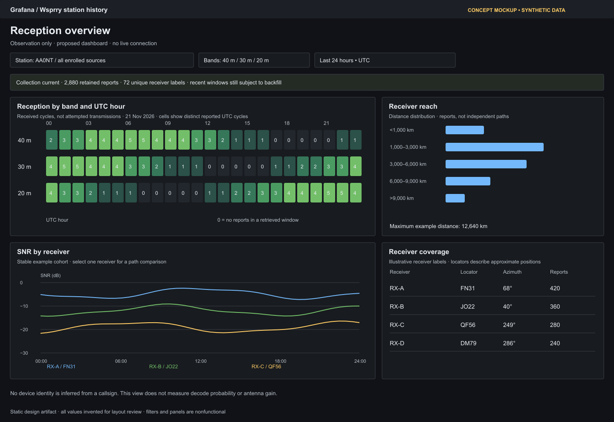
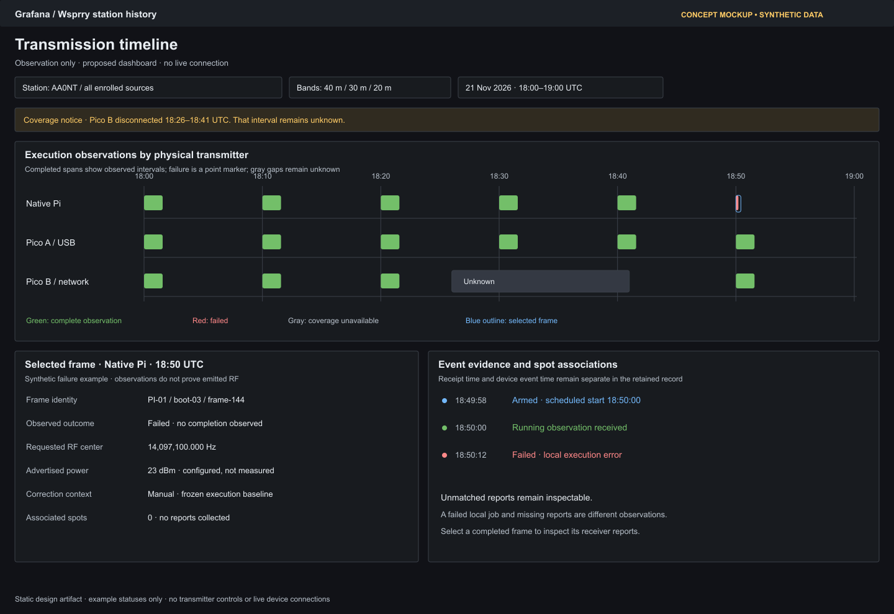
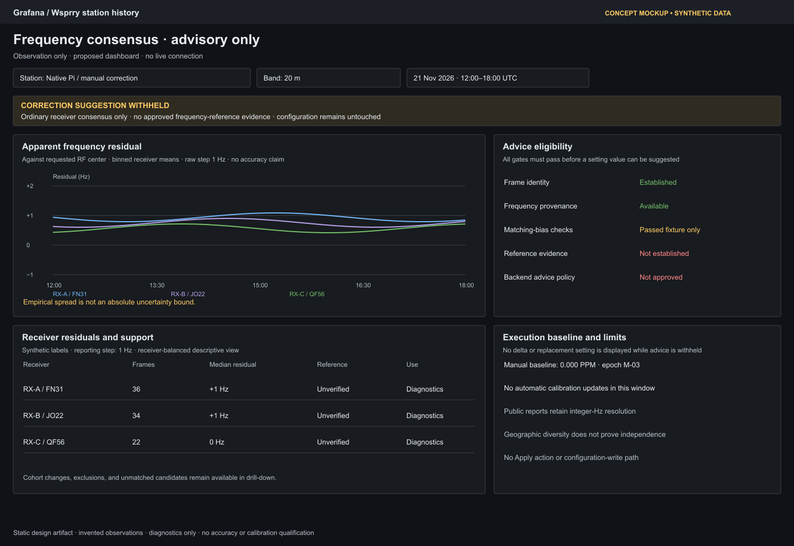

# Shared Pi/Pico transmission history and Grafana plan

## Status and scope

This document proposes an independent station-history and WSPR spot collector feeding PostgreSQL and Grafana. It is a planning document, not an implemented interface or an authorization to deploy services, change logging policies, operate hardware, or transmit. Initial delivery uses existing Pi/Pico observations and public spots, starting with reception charts and then a transmission timeline. No new sensors are required.

The source review used WsprryPi `devel` at `44b7e4c10c252b1d9216ad5e8681a4507b1519af` and WsprryPico `codex/issue-473-device-owned-scheduling` at `05cc90d67442c536f1cf7bee74a94914ad032c23`. Both working trees were clean during inspection. These are planning references, not qualified deployment candidates. Reinspect the intended source pair before implementation; Pico behavior on the inspected side branch must not be described as delivered on `devel`.

## Intended outcome

An operator can compare reception across bands, UTC hours, distances, and directions, then inspect what a particular physical transmitter was observed doing and which public reception reports can be associated with its individual WSPR frames. Missing observations, incomplete upstream retrieval, and ambiguous station identity remain visible.

The initial charts describe observed reception. They do not establish receiver availability, decode probability, independent RF accuracy, actual radiated power, antenna gain, or propagation failure from an absence of spots.

## Feature overview: planned capabilities

The following headlines and descriptions summarize planned end-user capabilities for Wsprry-History. They do not describe implemented or released features. Availability depends on completion of the applicable implementation slices, supported observation access, retained evidence, and their acceptance criteria.

- **See where your signal goes.** Explore reception by band, distance, direction, and receiving station.
- **Find your station's best operating windows.** Discover which bands and UTC hours consistently produce reports. These are observed reception patterns, not guarantees or automatic schedule changes.
- **Put every observed transmission on the timeline.** Review Pi and Pico activity together, including completed, failed, aborted, and skipped transmissions where supported observations establish those outcomes. Collection gaps remain visible; a complete record of all transmissions is not promised.
- **Connect each transmission to its reception reports.** Select a WSPR frame to inspect who heard it, how far it travelled, and its reported signal strength. Unmatched reports and ambiguous associations remain explicit.
- **Follow your station's performance over time.** Compare reception across days and revisit earlier operating periods within the selected retention policy.
- **Spot frequency drift before it becomes a mystery.** Track apparent frequency offsets across receivers and distinguish stable patterns from changing observations. Receiver and propagation effects remain part of the interpretation.
- **Get correction advice backed by evidence.** Eligible manually calibrated configurations can receive advisory suggestions when verified references and sufficient evidence support them. Changes remain under operator control, and ordinary receiver consensus alone does not qualify a suggestion.
- **Know when the picture is incomplete.** Clearly marked collection gaps, delayed reports, and ambiguous matches help prevent misleading conclusions.
- **Keep collecting when the dashboard is closed.** Background collection retains history independently of the browser, subject to source availability and the configured retention policy.
- **Check your station from a desktop or phone.** Planned Grafana views provide a broad reception overview and focused transmission details, with desktop and mobile review included in implementation acceptance.

Reception charts and the observed transmission timeline come first. Frequency advice is a later advisory-only slice, initially limited to selected configurations and single-frame WSPR qualification on 20 m with a 40 m cross-check. The approximately 1 Hz target remains provisional, and no accuracy claim or automatic correction is implied. The detailed scope, eligibility rules, unresolved decisions, and acceptance criteria below govern these descriptions.

## Architecture and ownership

### Selected repository and open deployment choice

The selected repository is `WsprryPi/Wsprry-History`, separate from the Pi and Pico application repositories. It will own the independently testable collector and observation adapters, analytical schemas and migrations, spot matching and advisory analysis, Grafana dashboard definitions, deployment definitions, tests, and its operator documentation. Application-owned producer interfaces remain in their respective repositories. Repository creation is not authorized by this decision and has not been performed as part of this plan.

The deployment choice remains open between a dedicated Linux VM and a spare Raspberry Pi. The exact host, Pi model if applicable, operating-system version, and storage device are not selected. The provisional sizing target is 2 vCPUs for a VM, or comparable available CPU capacity on a Pi, 4 GB RAM, and 100 GB of SSD-backed storage for the colocated collector, PostgreSQL, and Grafana. These are planning resources, not measured requirements or a hardware purchase decision; validate them against actual ingestion, queries, retention, and maintenance headroom. Backup capacity is additional.

The proposed deployment keeps those services on one always-on Linux host, separate from active transmitter execution and browser lifecycle. Service packaging and exact resource limits remain open. A central host cannot directly consume another Pi's local journal without a supported read-only access/export route; slice A must resolve that route and any station-side adapter requirement. Selecting the repository or a host class authorizes no deployment, installation, service changes, or implementation.

### Data flow and authority

```text
Pi runtime observations and journal ----+
                                       |
Pico read-only status and USB logs -----+--> Station collector --> PostgreSQL --> Grafana
                                       |
wspr.live bounded spot queries ---------+
```

One collector runs on an explicitly selected always-on Linux host, which may be a Pi or a separate computer. Collection is independent of an open browser. The collector observes, normalizes, retains, and associates data; it has no transmission, scheduling, configuration-write, or recovery authority. Database or collector failures must not delay or alter transmitter execution.

Reuse the existing Pi USB-log collection path rather than competing for a Pico Logging port. Read-only network status can support a network-connected Pico, with explicitly lower historical completeness when event records are unavailable. Determine supported observation access and authorization in slice A; an internal socket or browser route is not automatically an external collector API.

Use a separate PostgreSQL database outside the applications' private settings, scheduling, and recovery storage. The collector has scoped write access; Grafana has read-only access to analytical views. PostgreSQL is the proposed initial storage choice because it supports the relational associations and Grafana queries required here. TimescaleDB, InfluxDB, and a second log database are not initial requirements.

Grafana queries retained local data rather than issuing public upstream queries on every dashboard refresh. Its PostgreSQL integration supports time series, tables, variables, and annotations: [data source documentation](https://grafana.com/docs/grafana/latest/datasources/postgres/) and [annotations](https://grafana.com/docs/grafana/latest/datasources/postgres/annotations/).

## Existing inputs and limits

| Input | Available information | Limit to preserve |
| --- | --- | --- |
| Pi runtime events and snapshots | Start, completion, failure, cancellation, skip, mode, frequency, station identity, advertised power, frame information, backend, and correction provenance | Live events are not a replayable, complete transmission archive; event timestamps are not independent RF measurements |
| Pi native journal | Existing application events and imported Pico USB records, with journal receipt metadata | Retention depends on host policy; rotation and disabled collection can remove history |
| Pico operations and job status | Current accepted job, nominal frequencies/duration, clock state, output observation, and bounded terminal outcomes | Terminal history defaults to eight records and a one-hour TTL; polling can miss transitions |
| Pico USB `TX_TIME`, `TX_LOCATION`, and `TX_CORRECTION` | Job-linked accepted start, time-source/uncertainty, location provenance, and frozen correction context | Emitted at accepted ARM, not proof of execution start; opaque controller waveforms do not provide inferred station identity |
| Pico USB lifecycle logs | Job/clock state changes, boot identity, origin sequence, monotonic/UTC timestamps, and drop counters | Bounded queues, filtering, disconnects, and rate limits prevent a lossless-history claim; generic job-state text does not itself contain a job ID |
| wspr.live spots | UTC, callsigns, locators, reported frequency, SNR, drift, advertised power, distance, band, mode, receiver version, and available upstream identity | Delayed, duplicate, erroneous, or corrected records are possible; a spot does not identify a physical transmitter by device ID |

Detailed Pico transmission records are local USB observations and are explicitly excluded from current UDP export. Existing UDP logging is an export-safe fixed-message channel, not a general transmission-history transport. Do not widen it incidentally.

Configured dBm and drive settings are not measured RF power. Nominal frequencies and selected corrections are not independent RF measurements. Pi support-bundle temperature, throttling, and core-voltage snapshots are not continuous telemetry or transmitter supply measurements. Periodic health sampling and new sensors are outside initial scope.

Source references:

- [Pi runtime events](../../src/scheduling_runtime.cpp), [runtime snapshot](../../src/scheduling.hpp), and [snapshot serialization](../../src/scheduling_websocket_status.cpp).
- [Pi local control and observation boundaries](../../src/application_control/README.md), [existing spot fetcher](../../WsprryPi-UI/data/fetch_spots.php), and [UDP logging contract](udp-logging.md).
- [Inspected Pico transmission records](https://github.com/WsprryPi/WsprryPico/blob/05cc90d67442c536f1cf7bee74a94914ad032c23/src/logging/transmission_record.hpp), [job service and history limits](https://github.com/WsprryPi/WsprryPico/blob/05cc90d67442c536f1cf7bee74a94914ad032c23/src/wtp/job_service.hpp), and [USB logging contract](https://github.com/WsprryPi/WsprryPico/blob/05cc90d67442c536f1cf7bee74a94914ad032c23/engineering/development/usb-logging.md).

## Shared analytical model

Initially, shared means collector adapters translate existing observations into one analytical model. It does not require identical producer messages or new firmware interfaces. The following records are conceptual; exact schemas, indexes, and bounds belong to slice A.

| Record | Proposed contents |
| --- | --- |
| Station | Stable device identity, Pi/Pico kind, display name, hostname history, and explicit callsign association periods |
| Source observation | Original bounded payload, source/carrier, trust classification, device/boot identity, sequence or journal cursor, event time, receipt time, and parser version |
| Transmission | Local job/occurrence identity where available, accepted mode/frequency/station fields, advertised power, backend, complete available frequency/correction chain, and field-level evidence |
| Transmission event | Scheduled/armed, observed running, completed, failed, aborted, skipped, or unknown, with supporting observation and timestamp semantics |
| WSPR frame | Individual frame and UTC slot, linked to its parent transmission or two-frame plan |
| Spot | Upstream identity/provenance, UTC, transmitter/receiver identities and locators, frequency, SNR, drift, power, distance, band, and mode |
| Spot association | Candidate frame, matching evidence, matcher version, and matched, ambiguous, or unmatched result |
| Collection coverage | Connected/disconnected intervals, known drops, journal loss, failed or capped upstream windows, and reconciliation progress |

Preserve exact source nanoseconds alongside database timestamps, with an explicit representation that cannot overflow or lose precision. Keep monotonic times scoped to their origin boot. UTC-unavailable events retain null UTC; receipt time is not substituted as an exact event time. Clock changes must not create invented durations or cross-boot ordering.

Keep raw observations sufficient to rebuild derived projections. Bound payload sizes and retained fields, exclude credentials and unrelated private state, and preserve provenance when reconciling repeated or corrected upstream observations. Decide whether source IDs are stable enough for upsert and how to retain correction revisions before implementation.

Existing origin identity, boot, sequence, and journal cursor can support deduplication, but they have different meanings. Sequence gaps alone do not prove transport loss because filtering also advances origin sequence. Separate positive drop evidence from unavailable coverage.

### Frequency provenance required before advisory analysis

Define the frequency chain in slice A and retain available execution-bound context in slice C, even though consensus analysis comes later. For each field, classify its evidence as accepted/requested, backend-reported realization, current observation, derived value, or unavailable. Software realization is not a measured RF frequency. Do not reconstruct an earlier accepted value from later configuration or infer an unavailable realization from a nominal request.

| Frequency-chain element | Required distinction |
| --- | --- |
| Dial and audio offset | Preserve their individual values and convention, rather than treating a field named frequency as necessarily an RF center |
| Random placement | Preserve the placement actually selected for that frame/plan, not merely whether random placement was enabled |
| Requested waveform | Preserve the nominal RF center and requested tone frequencies or an exact reconstructible waveform convention/version |
| Backend realization | Retain available per-event synthesis adjustments, realized tone frequencies, and quantization; mark absent observations unavailable |
| Selected correction | Preserve manual, automatic, intrinsic, and residual components where applicable, their composition rule, units, source, generation, and the execution-frozen result |
| Execution binding | Bind the chain to executor, boot, backend/profile, job/frame, configuration revision where available, and correction/reference epoch |
| Decoder/upstream convention | Preserve the validated reported-frequency reference, units, precision, and decoder/source versions used to derive a comparable residual |

The inspected Pi WSPR snapshot exposes a dial frequency and placement offset; the inspected Pico accepted-frequency presentation is populated from requested event frequencies. Neither is automatically the backend-realized RF-frequency baseline. Slice A must prove which supported observations can retain the required chain and identify gaps. Existing reception charts and partial timelines remain useful when calibration provenance is missing; those records are ineligible for configuration advice. Any new producer interface needed to close a gap requires a separate scope decision.

## Provisional storage estimates and proposed retention

These estimates are provisional planning assumptions, not measurements of an implemented collector or a qualified capacity allocation. Assume 1–3 KB per retained spot and 5–15 KB per transmitted WSPR frame's history allocation, including associated raw evidence and database indexes. Count individual frames, including each frame of a two-frame plan. Use decimal units: 1 KB = 1,000 bytes, 1 MB = 1,000,000 bytes, and 1 GB = 1,000,000,000 bytes; annual estimates assume 365 days of continuous operation.

| Per-station example | Transmitted frames/day | Average reports/frame | Spots/day | Estimated storage/day | Estimated storage/year |
| --- | --- | --- | --- | --- | --- |
| One frame every ten minutes | 144 | 20 | 2,880 | 4–11 MB | 1.3–3.9 GB |
| One frame every two minutes | 720 | 50 | 36,000 | 40–119 MB | 14–43 GB |

Estimate daily storage as `(frames × reports per frame × retained bytes per spot) + (frames × retained bytes per frame history)`. Receiver report volume is a major variable. Operating on multiple bands does not multiply these estimates unless it increases the total frame or report count. An illustrative three-station deployment at the ten-minute rate would retain approximately 4–12 GB/year under these assumptions; this is not an assertion about the enrolled fleet's actual activity.

Retaining every status poll can dominate storage: a 2–5 KB snapshot every five seconds produces 17,280 snapshots/day, approximately 35–86 MB/day or 13–32 GB/year per device, even while idle. This overhead is additional to the frame/spot estimates when stored separately; avoid counting shared raw evidence twice. Prefer retained state changes and periodic checkpoints, with a short rolling retention window for repetitive raw polls. Checkpoint cadence and event-context preservation remain design decisions.

The estimates exclude backups, replication, PostgreSQL write-ahead logs, temporary imports, maintenance headroom, and any additional reference-beacon collection. Advisory consensus results should be small relative to their supporting spots and execution context, but their actual size and evidence-retention cost must also be measured. Final storage allocation requires measured table/index sizes, observed report volume, and the selected retention policy.

Proposed retention policies, pending confirmation:

| Data class | Proposed retention | Evidence boundary |
| --- | --- | --- |
| Repetitive raw status polls | 7–30 days | Preserve required event/correction context separately before expiration; polling snapshots are not complete execution history |
| Spots and transmission/frame history | One year initially | Include the observation provenance needed to interpret retained records; establish how expiry affects rebuilding derived projections |
| Hourly/daily summaries | Long term | Preserve metric definitions, aggregation versions, and coverage indicators; summaries do not replace raw evidence for frame-level analysis |
| Evidence supporting correction advice | Retain with the advisory result | Preserve the supporting spots, accepted frequency/correction context, cohort, estimator version, and reference evidence where used; an active advisory result must not silently outlive its evidence |

Retention expiry must not silently leave a claim of full replayability or reproducibility. Define evidence pinning, deletion dependencies, backup retention, and the behavior of expired advisory results before enabling automated retention. These are proposed analytical-data policies only; they do not change journald, application settings/recovery retention, or Pico storage.

## Spot collection

Use the documented wspr.live HTTP query interface. The existing Pi spot-fetching code provides useful lookup and normalization references, but its display cache and latest-250-row ClickHouse query are not a historical ingestion pipeline.

Proposed defaults, pending confirmation:

- Enroll explicit callsigns, association periods, and relevant bands; do not collect the full worldwide archive.
- Poll approximately every two minutes with overlapping UTC windows and a shared upstream request budget across all stations.
- Reconcile a bounded recent 24-hour window for delayed reports, with explicit historical backfill ranges.
- Filter queries by time and band, use deterministic pagination or subdivided time windows, and never mark a capped response complete. Resolve dense single-slot windows without silently dropping rows.
- Commit rows and retrieval checkpoints transactionally; replay after restart must not inflate counts.
- Apply bounded responses, timeouts, backoff, and clear unavailable states. A failed query must not become a successful zero-row interval.
- Retain upstream record identity where available, plus source namespace and provenance. Repeated retrieval must not collapse distinct receiver reports.

The upstream service recommends bounded time-and-band queries and reconciles delayed data from daily exports. Initial polling and reconciliation defaults require load review against actual station volume and the service's current policies: [wspr.live documentation and terms](https://wspr.live/). No upstream completeness guarantee is implied by a successful query. Follow its noncommercial and free-access conditions; resolve their applicability to the intended dashboard access model before deployment.

## Transmission observation and association

### Pi adapter

Retain supported runtime start, completion, failure, cancellation, and skip observations with corresponding station/runtime context. Capture accepted execution context where the current source exposes it; do not label a current configuration read as historical accepted context. Source inspection in slice A must establish which fields can be bound atomically and which remain unavailable.

Use an existing supported read-only observation surface if sufficient. Do not read or write the private settings database as a shortcut. If access or correlation requires a new supported interface, record that as an explicit scope decision rather than claiming the existing-data slice can supply it.

### Pico adapter

Combine existing read-only operations/job observations, retained terminal outcomes, and USB logs collected by the existing Pi path. Associate detailed ARM records by their job ID. Recover outcomes from terminal records when possible. Associate generic lifecycle events only when supporting identity and ordering make the association unambiguous; otherwise retain them as unassociated observations.

Snapshot settings only with their observed revision and time. Do not infer a previous frame's callsign, locator, or power from later settings, or decode an opaque waveform by guessing from current configuration. A running state observed during polling is evidence that the job was running at observation, not its exact start instant. ARM evidence remains distinct from running and completion evidence.

### Cross-source identity

Use the physical executor's stable identity as the station identity. A Pi controlling a Pico is an observer/controller of that Pico execution, not a second transmitter. Link their observations only through explicit available job/execution bindings. Where no such binding exists, preserve separate unresolved observations instead of manufacturing a common transmission ID. Define source precedence and conflict handling in slice A.

### Frame-to-spot matching

- Match individual WSPR frames by UTC slot, encoded callsign semantics, band/mode, available locator evidence, and frequency context.
- Preserve parent plans and individual two-frame identities. Handle compound and hashed calls explicitly; unknown encoded identity remains unknown.
- Treat frequency as supporting evidence because receiver offsets affect reported frequency.
- Keep multiple same-callsign transmitters ambiguous when available evidence cannot distinguish them.
- Allow late spots to attach or revise an association without duplicating the spot; retain matcher provenance.
- Keep unmatched spots visible. A positive remote report can establish reception even when local execution evidence is missing; it must not fabricate a local start or completion observation.

Keep a calibration candidate set and its rejection reasons auditable independently of the final frequency-filtered associations. Prefer time, encoded identity, and independently available station context when those establish an unambiguous association. Do not use the consensus estimate being evaluated to tighten matching and then claim the selected residuals independently confirm it. Where frequency is necessary to distinguish candidates, expose that selection and withhold advice if its bias cannot be bounded. Broadening a search must not resolve same-callsign collisions by assumption.

A completed local transmission with no associated spots is labelled “No reports collected.” It is not automatically a propagation failure, a failed decode, or proof that a remote receiver was listening. Show partial or unavailable collection coverage alongside this label.

## Grafana views

### Reception dashboard

| Panel | Operator question | Interpretation |
| --- | --- | --- |
| Unique receivers and received UTC cycles by band | Where and when was the signal reported? | Received cycles are not a count of all attempted transmissions |
| UTC-hour by band heat map | Which operating windows repeatedly produce reports? | Show sample support and selected date range |
| Distance distribution and maximum distance | What is typical reach, and what are the outliers? | Maximum distance alone is not overall performance |
| Per-receiver SNR over time | How does a consistent path change? | Do not silently combine changing receiver populations |
| Receiver map | Where are reports coming from? | Derived locator positions have locator precision |
| Collection status | How fresh and complete are these observations? | Distinguish zero reports, pending reconciliation, and missing data |

Initial reception filters identify callsigns and dates, not necessarily uniquely identified physical transmitters. Device filters become authoritative only where a supported association exists. Query retained data by explicit time range, band, station/callsign, and receiver as appropriate.

### Transmission timeline

Provide one lane per physical transmitter with separate armed, running, completed, failed, aborted, skipped, and unknown observations. Do not extend a last-known running state indefinitely through a collection outage. Render exact intervals only when supported; otherwise show point observations or explicitly bounded/estimated intervals.

Selecting a transmission opens its accepted or observed settings, individual frames, supporting events, outcome evidence, correction context, and associated receiver reports. Show uncertain associations separately. Proposed overlays include clock-state changes, reboot/disconnect events, and collection gaps from existing observations.

Apply Impeccable during eventual dashboard design and review. Preserve Grafana's familiar operating patterns, provide textual state labels rather than color alone, keep units and UTC semantics consistent, and make freshness and missing-data states prominent. Desktop and mobile rendering checks are acceptance work for implementation, not completed evidence in this plan.

### Static dashboard mockups

These Grafana-style concept images use synthetic data for layout and terminology review. They are static documentation assets, not screenshots of implemented dashboards, importable Grafana JSON, working controls, or evidence of collection, transmission, or calibration. Example identifiers, counts, traces, eligibility states, and timestamps are invented. The dark palette follows familiar Grafana panel patterns; final theme choice and panel configuration remain implementation decisions.

| Mockup | Planning scope | Editable source |
| --- | --- | --- |
| [Reception overview](transmission-history-mockups/reception-overview.png) | Slice B: UTC-hour/band reception, distance distribution, receiver SNR, coverage, and collection freshness | [SVG](transmission-history-mockups/reception-overview.svg) |
| [Transmission timeline](transmission-history-mockups/transmission-timeline.png) | Slices C–D: physical-executor lanes, unknown coverage interval, selected-frame outcome, and evidence context | [SVG](transmission-history-mockups/transmission-timeline.svg) |
| [Advisory frequency analysis](transmission-history-mockups/frequency-consensus-advisory.png) | Slice E: apparent residuals, receiver support, execution baseline, and explicit withholding of configuration advice | [SVG](transmission-history-mockups/frequency-consensus-advisory.svg) |
| [Mobile timeline](transmission-history-mockups/transmission-timeline-mobile.png) | Proposed narrow-screen adaptation: one selected station, recent observations, frame details, and evidence quality | [SVG](transmission-history-mockups/transmission-timeline-mobile.svg) |

#### Reception overview concept



The receiver table illustrates a coverage summary; the planned receiver map is not depicted. The SNR traces represent illustrative aggregated bins, not raw integer-valued samples. A retrieved window containing zero reports remains distinct from unavailable collection. Final panels must expose their aggregation definitions and support counts.

#### Transmission timeline concept



The selected failure and the disconnected interval demonstrate different outcomes. A failure observation is not proof of completed RF output, and a disconnect does not extend a last-known running state. Detailed observation timestamps and provenance remain available through the planned drill-down. Ambiguous spot associations must remain separately labelled in implementation; this static example does not demonstrate every matching state.

#### Advisory frequency analysis concept



Ordinary receiver consensus remains diagnostic-only in this example. Binned fractional means of integer-Hz reports do not establish sub-Hz accuracy. The eligibility panel deliberately withholds a configuration suggestion despite apparent receiver agreement, and the view contains no Apply control. Fixture-state labels are illustrative and do not claim that acceptance checks have been run for an implementation.

#### Mobile timeline concept


At narrow widths, the proposed layout selects one station and uses a vertical observation list rather than shrinking the multi-station desktop chart. Unknown rows indicate unavailable observations at the displayed slots, not confirmed accepted jobs. This mobile image illustrates the timeline workflow only; reception and advisory mobile layouts remain part of their implementation slices.

The PNG previews were rendered from the editable SVGs and inspected at 1,440-pixel desktop and 390-pixel mobile widths. Impeccable review covered legibility, layout, units, synthetic-data disclosure, gap semantics, and the advisory-only boundary; its mechanical detector reported no findings for the SVG assets. Static visual review does not validate Grafana interactions, keyboard accessibility, real queries, responsive code, or runtime behavior. Those checks remain the applicable slice acceptance criteria.

## Implementation slices and acceptance criteria

The slices are sequential review boundaries. Saving this plan authorizes none of their implementation, deployment, or hardware work. Approving one slice does not authorize later slices automatically.

### Slice A: Data foundation and access verification

Deliver the shared analytical schema, source-to-field mapping, evidence/identity rules, observation-access inventory, representative recorded or synthetic fixtures, and a deployment proposal for the selected `WsprryPi/Wsprry-History` repository. Compare the still-open dedicated-VM and spare-Pi options without assuming either is selected. Distinguish fields available through supported interfaces from internal-only values and unavailable historical values.

Acceptance criteria:

- Every field has a source, unit, timestamp meaning, null/unknown behavior, and retention/completeness classification.
- Pi and Pico identity mappings cover boot changes, hostname changes, controller/executor roles, and cloned or conflicting identities.
- Accepted settings are distinguished from current settings; ARM, observed running, completion, and RF measurement remain separate.
- Exact time/frequency representations preserve precision; monotonic timestamps cannot be joined across boots as absolute time.
- Duplicate, conflicting, corrected, filtered, malformed, and missing observations have documented handling.
- Supported access can be used without competing for USB ownership or granting transmitter/configuration authority. Any required interface change is separately identified for approval.
- Produce a per-backend/mode frequency-provenance and observability matrix covering dial/audio offsets, actual random placement, requested tones, realization adjustments, correction composition, and execution bindings. Define how slices C–D preserve these fields before raw polls expire; explicitly classify unsupported or unavailable combinations.
- Define the initial analysis goal and proposed band/backend precision targets, distinguishing apparent-offset diagnostics, stability tracking, and reference-supported correction advice. Unapproved targets and unavailable required observations remain explicit blockers for advice, not for reception charts.
- Open decisions required by slices B and C have owners and resolutions or explicit blockers.

### Slice B: Spot collector and reception dashboard

Deliver station-scoped spot collection, transactional checkpoints, bounded backfill/reconciliation, PostgreSQL views, and the reception dashboard. No Pi/Pico producer changes are required by this slice's intended scope.

Acceptance criteria:

- Replaying a window or restarting after interruption does not inflate spot, receiver, or cycle counts.
- Capped, failed, malformed, or interrupted responses cannot advance a checkpoint as complete; dense windows have a validated retrieval strategy.
- Delayed and corrected records follow the defined reconciliation policy, with provenance retained.
- Multiple enrolled stations share bounded upstream load; rate limits and outages trigger backoff and truthful freshness indicators.
- Dashboard totals reconcile with inspectable retained rows for selected windows; timezone and band filters are consistent across panels.
- Historical spot-only data is usable without inventing local transmission history or physical device identity.
- Measure actual retained spot-row, raw-payload, and index sizes, total database growth, write-ahead-log/temporary-space demand, and representative backup size using a documented sample volume and observation period. Reconcile measurements with row counts and observed ingestion rates, then revise the provisional estimates and capacity/retention proposal before selecting the deployment storage budget; distinguish measured values from extrapolations.
- Desktop/mobile visual review covers populated, empty, stale, partial, and error states with accessible labels and units.

### Slice C: Pi/Pico transmission collection and timeline

Deliver adapters using the access boundaries approved in slice A, retained observations and derived transmission/frame records, and the station timeline. Continue to expose existing-source limitations rather than requiring a new firmware history interface implicitly.

Acceptance criteria:

- Pi starts, completions, failures, cancellations, and skips retain available context and evidence.
- Pico ARM records cannot become execution-start evidence; terminal records and generic lifecycle events associate only when identity supports it.
- Collector restart, journal rotation, USB/network disconnect, origin reboot, disabled logging, clock loss/change, filtered events, and queue loss produce explicit coverage or unknown states.
- Multiple observers of one executor do not double-count its transmissions when explicit identity bindings exist; unresolved bindings remain visible.
- No accepted setting or exact duration is reconstructed from later settings, polling alone, or receipt-time substitution.
- Retain the available frequency chain defined in slice A with its execution binding, field-level provenance, and correction/reference epochs. Missing realization or selected-correction evidence is explicit and prevents advice for affected records; it does not silently broaden producer scope.
- Collector/database backpressure cannot block transmission or mutate settings, scheduling, or recovery state.
- Timeline drill-down exposes provenance and remains usable for multiple stations on desktop and mobile.
- Extend slice B's storage measurements to actual transmission histories, state-change/checkpoint records, and repetitive status polls under active and idle profiles. Validate the proposed retention behavior without removing context required by retained history or advisory evidence.

### Slice D: Combined transmission/reception view

Deliver frame-to-spot matching, ambiguity handling, late association, and transmission detail panels linking local observations to reports.

Acceptance criteria:

- Tests cover ordinary and two-frame WSPR, compound/hashed identity, changed settings, same-callsign concurrent transmitters, receiver frequency offsets, unmatched spots, and unavailable local history.
- Late spots and revised matcher decisions update associations without duplicate reports or fabricated local execution evidence.
- Association decisions are inspectable and versioned; ambiguous candidates are never silently assigned to one device.
- Inject offsets both inside and outside proposed frequency-matching tolerances, including same-callsign collisions. The calibration candidate path must retain an unambiguously attributable offset or refuse advice with an inspectable ambiguity/selection reason; it must not silently discard displaced reports and publish a near-zero result. Record candidate counts, exclusions, and residual-dependent selection for slice E.
- “No reports collected” remains distinct from collection failure, pending reconciliation, and a locally failed transmission.
- Counts and drill-down rows agree across reception and timeline views for the same filters.

### Slice E: Advisory frequency-consensus calibration

After slices A–D, deliver observational estimates of apparent transmitter frequency error and stability, with supporting receiver reports and explicitly qualified uncertainty. Configuration suggestions are a separately gated output within this slice, not an automatic consequence of receiver consensus. This slice is advisory only: the collector and Grafana do not apply corrections, write configuration, change calibration providers, or schedule validation transmissions. Any operator-applied correction remains a separate action through the existing approved workflow.

For each matched frame, compare reported frequency with the intended frequency expressed using the validated decoder reporting convention. The residual combines transmitter error, receiver error, propagation Doppler, and decoder/reporting effects. Agreement between receivers supports an apparent-offset estimate; agreement alone does not establish absolute accuracy. Precisely referenced receivers can still observe propagation-induced shifts; see the [Doppler measurement explanation](https://hamsci.org/doppler-instructions).

Selected calibration goals and initial eligibility defaults:

The initial goal is persistent frequency-offset and stability diagnosis, followed by reference-supported manual correction advice where qualified evidence permits it. Identify repeatable offsets, distinguish receiver/path changes where possible, and withhold a setting suggestion unless its predicted improvement exceeds the approved uncertainty. Ordinary receiver consensus remains diagnostic-only.

Start advisory qualification with ordinary single-frame WSPR on 20 m, followed by a 40 m cross-check. Evaluate whether a persistent offset can be reduced to approximately 1 Hz on the tested band. The 1 Hz value is a provisional engineering target, not an established accuracy specification, qualified acceptance threshold, or promise of achievable performance. Validate feasibility against integer-Hz spot resolution, backend realization, reference evidence, and the full uncertainty budget before approving a numerical target. Other bands may retain reception and attributable diagnostic views but are outside initial correction-advice qualification.

| Configuration | Diagnostic eligibility | Initial correction-advice default |
| --- | --- | --- |
| Pi Si5351, crystal reference, fixed manual correction | Attributable frames with comparable frequency conventions | First-group validation candidate |
| Pico direct GPIO, fixed manual correction, automatic RF calibration disabled | Attributable frames with comparable frequency conventions | First-group validation candidate |
| Pico Si5351, crystal reference, fixed manual correction, automatic calibration disabled | Attributable frames with comparable frequency conventions | First-group validation candidate |
| Pi legacy GPIO, fixed manual correction | Attributable frames with comparable frequency conventions | Second group; first validate processor-specific correction composition and provenance |
| Pi RP1 GPCLK, fixed manual correction | Attributable frames with comparable frequency conventions | Second group; first validate clock model, realization, and correction semantics |
| Pi GPIO using system-clock estimates or direct PPS calibration | Diagnostics separated by correction/reference epoch | Diagnostic-only initially |
| Pico GPIO or Si5351 using automatic GPS-derived calibration | Diagnostics separated by correction/reference epoch | Diagnostic-only initially |
| Si5351 driven by an external frequency reference | Diagnostics where attribution and conventions support them | Diagnostic-only initially; establish reference ownership and correction authority before any later expansion |
| Experimental backends, unsupported profiles, or incomplete frequency provenance | Only the observations justified by available evidence | No configuration suggestions |

Candidate means selected for validation, not qualified or already supported for advice. Eligibility is determined by the physical executor and its actual correction/reference path, not by whether a Pi or Pico controller submitted the job. No configuration may receive a setting suggestion before its provenance, reference, uncertainty, matching-bias, and backend-specific gates pass.

For first-group candidates, require a stationary, uniquely attributable transmitter, a conventional callsign in an ordinary single-frame WSPR message, and a fixed backend/reference configuration and manual correction throughout the evidence window. Retain exact accepted frequency context, including actual random placement and available synthesis adjustments, and validate the receiver/reporting convention. Random placement is eligible only when its selected value is known; incomplete context blocks advice. Two-frame plans and other identities remain supported by the broader history/matching design but are outside initial correction-advice qualification.

Advice targets the applicable existing operator-facing manual correction, not intrinsic chipset compensation or a replacement GPS-derived estimate. A single-band result cannot qualify a global PPM setting across all bands. Use the 40 m cross-check to evaluate consistency before recommending broader applicability; if evidence is inconsistent, withhold broader advice. Even a successful two-band check does not qualify untested bands or conditions. Exact setting names, formulas, and validation procedures remain open until the backend mapping is verified.

Prerequisites:

- Reliable frame associations from slice D, including explicit handling of concurrent same-callsign transmitters, two-frame plans, and ambiguous reports.
- Exact intended frequency and the correction actually selected for the accepted execution, bound to the physical transmitter, backend, job/frame, and observation period. Current settings alone are insufficient.
- Validated mappings between transmitter frequency conventions and each supported decoder/reporting convention, including the four WSPR tones, nominal center, tone-zero references, units, and upstream rounding or quantization. An unexplained reference-point difference must not be interpreted as oscillator error.
- Retained receiver identity, locator, observation time, and available software/provenance, with an explicit policy for receiver changes or multiple receivers sharing one callsign. A callsign alone does not prove an independent or stable frequency reference.
- Defined minimum support, age limits, observation windows, outlier rules, cohort rules, and uncertainty method. These values require evidence and review rather than arbitrary constants presented as qualified limits.
- Independently documented frequency-reference evidence before any receiver is classified as verified. GPS position, UTC synchronization, a callsign label, or a claimed GPSDO is insufficient to establish the receiver's active frequency accuracy by itself.
- A validated backend-specific correction convention before displaying a suggested configuration value. Apparent measured error and the correction to enter must remain separate fields; no sign is assumed across Pi/Pico backends.

Output eligibility:

| Output class | Eligibility and permitted claim |
| --- | --- |
| Apparent-offset/stability diagnostics | Comparable frequency conventions and attributable observations; ordinary receivers may support descriptive apparent offsets and stable-cohort trends, with receiver/path bias unresolved. No suggested configuration value follows from this class alone |
| Reference-supported correction suggestion | All frequency-provenance, matching-bias, support, freshness, reference-evidence, and uncertainty gates pass for an explicitly approved backend/mode. A verified receiver or reference-beacon method needs an approved uncertainty basis; a reference label alone does not qualify advice |

The selected defaults above define qualification scope, not completed qualification. Until the detailed backend/mode matrix, numerical error targets, reference method, and uncertainty budget are validated and approved for use, correction suggestions remain unavailable. Automatically calibrated and externally referenced configurations are diagnostic-only initially; any later residual-trim eligibility requires a separate scope decision. Ordinary-receiver consensus is not sufficient to recommend a configuration change, regardless of receiver count or apparent agreement.

Correction advice must distinguish observed residual error, a proposed setting delta, and the resulting replacement setting value. Name the exact backend setting and units, retain its execution baseline/revision and all composed correction components, and validate composition without double-applying an existing correction. A suggestion targets only that recorded baseline; it is not a portable global PPM recommendation. The exact permitted target settings and composition methods remain unresolved until the backend matrix is reviewed.

Invalidate current advice on a relevant settings/correction-generation change, automatic calibration update, backend/profile/reference change, conflicting provenance, expired reference evidence, lost supporting evidence, or age limit. A reboot invalidates advice unless a separately validated identity/baseline continuity rule proves applicability; no such exception is assumed initially. Retain invalidated results as historical evidence with a reason, never as current advice. An automatically changing correction must not be mistaken for a stable manual baseline.

Reference choices and trial minimum evidence:

The following values are selected planning defaults for qualification experiments, not established accuracy guarantees, production-qualified thresholds, or a substitute for a validated uncertainty method. They do not enable advice by themselves. Keep the approximately 1 Hz outcome target provisional, and withhold configuration suggestions until reference verification, source conventions, backend semantics, matching-bias checks, and the uncertainty decision rule are approved and validated.

| Reference choice | Initial use |
| --- | --- |
| Ordinary public receivers | Apparent-offset and stability diagnostics; no configuration suggestions |
| Two independently referenced receiver systems | Preferred basis for initial reference-supported advice, subject to documented active frequency accuracy and a complete path/reporting uncertainty budget |
| Trusted WSPR reference beacons heard by the same receivers | Defer receiver-bias subtraction initially; later inclusion requires separate beacon enrollment, provenance, query/storage budget, and treatment of different propagation paths |
| An independently referenced local receiver or frequency measurement | Useful independent validation when available and separately authorized; not a mandatory new sensor or hardware operation in the initial collector scope |

A verified receiver needs retained evidence of its actual frequency-reference connection, active receiver configuration and reporting convention, reference accuracy, and lock or valid holdover covering the included observation window. GPS location and UTC synchronization alone do not qualify it. Two callsigns sharing receiver hardware or an oscillator do not count as two independently referenced systems. Independent reference systems also do not prove independent propagation errors. The actual receiver identities, reference devices, verification procedures, provenance format, and acceptable holdover rules remain open; no existing station is designated verified by this plan.

| Evidence gate | Trial default |
| --- | --- |
| Verified references | Two independently referenced receiver systems with evidence covering the included frames |
| Additional corroboration | At least one additional receiver as a diagnostic cross-check; define its required overlap during qualification rather than treating any unrelated report as corroboration |
| Common observations | At least 12 distinct transmitted frames heard by both verified receivers, with one retained report per receiver/frame for support counting |
| Observation span | At least two hours within one unchanged transmitter/backend/reference/manual-correction epoch |
| Temporal stability | Compare two chronological blocks containing at least six common frames each; blocks are a stability check, not a claim of statistical independence |
| Receiver agreement | Verified receivers' window estimates agree within 1 Hz and are consistent with their documented uncertainty budgets |
| Attribution and selection | Unambiguous frame identity, accepted-frequency provenance, and passed offset-injection and matching-sensitivity checks |
| Reference state | Reference evidence covers included frames; unsupported lock/holdover intervals are excluded |
| Freshness at generation | The latest included transmitted frame is no older than 30 minutes, measured from frame time rather than collection receipt |
| Advice lifetime | At most one hour from generation, with earlier invalidation on any baseline, reference-validity, supporting-evidence, or relevant configuration change |

Twelve common frames at a ten-minute cadence can require more than two hours when reports are missing. Longer evidence windows are acceptable only within a stable, relevant baseline. Define a maximum window age/span during qualification; the minimum two-hour span and fresh last frame do not justify including arbitrarily old observations. Do not average genuine transmitter drift away to satisfy receiver agreement.

The additional receiver does not gain reference status through corroboration and cannot dominate the verified-reference estimate by supplying more reports. Disagreement must be visible and investigated. An unexplained conflict is not silently discarded, but an unverified receiver's bias does not automatically veto otherwise qualified reference evidence. Define the conflict-resolution and withholding rule before permitting suggestions.

Let U denote a conservative uncertainty allowance in Hz for the reference-supported residual, including reference error, propagation, reporting quantization, backend realization, and observed variability. The uncertainty construction, coverage interpretation, dependence treatment, and systematic-error bounds remain unresolved. U is not merely receiver spread, a standard error calculated from report count, or an assumed confidence interval.

The trial 20 m advice gate requires U ≤ 1 Hz, an apparent offset magnitude of at least 2 Hz, and that magnitude strictly greater than 2U. Evaluate the rounded, permitted setting change through the validated backend model and withhold it if its predicted improvement does not survive the uncertainty allowance. The precise improvement decision rule and any correction-size limit remain open pending qualification. Passing these coarse-offset gates does not establish that the corrected transmitter will be accurate to 1 Hz; that remains a provisional outcome to evaluate independently.

After an operator applies a correction, use a new observation window meeting the same evidence gates. The training window is never reused as validation evidence. Perform the planned 40 m cross-check before recommending broader applicability, comparing inferred PPM behavior and uncertainty rather than requiring identical Hz offsets. Withhold fixed-correction advice when drift or incompatible block estimates prevent a stable result, with a reason such as “Frequency changing—fixed correction withheld.” No trial policy authorizes scheduling or transmitting the required observations.

Proposed analysis and views:

- Compute per-report residuals in Hz and PPM using the validated frequency reference and appropriate nominal RF frequency.
- Define the estimand before pooling: same-frame receiver consensus and across-frame stability trends are separate products. Compare stable cohorts and stable correction/reference epochs; missing simultaneous coverage must not masquerade as within-frame agreement. Distinguish error against the intended target from known synthesis realization error rather than removing one silently.
- Summarize repeated observations per receiver and use a robust receiver-balanced consensus so one prolific receiver cannot dominate. Show support and excluded observations, not just the central estimate.
- Track stable receiver cohorts and display cohort changes. Separate within-cohort trends from shifts caused by a changing reporting population; report geographic diversity without assuming paths are statistically independent.
- Compare repeated observations across bands and correction epochs. Approximately consistent PPM error across frequencies may support an oscillator scale-error hypothesis; synthesis behavior, fixed offsets, receiver bias, and propagation remain alternative contributors.
- Keep ordinary-receiver consensus separate from a verified-reference-receiver estimate. Optionally evaluate receiver-bias estimates using trusted reference beacons heard by the same receivers near the same time and frequency; preserve the reference's uncertainty and the difference between propagation paths.
- Plot consensus apparent error in Hz/PPM, per-receiver residuals and spread, applied correction epochs, cohort changes, and collection gaps. Present insufficient, stale, ambiguous, or conflicting evidence explicitly.
- Show any suggested correction with its backend, evidence window, reference quality, estimator version, uncertainty assumptions, and expiry. Subsequent independently collected observations evaluate an operator-applied change; the sample used to derive a correction is not its validation sample.
- If trusted reference beacons are used, explicitly enroll their callsigns, observation periods, and required bands; budget the additional queries, storage, and evidence retention. Station-only collection does not implicitly authorize or supply that reference dataset.

Acceptance criteria:

- Deterministic fixtures demonstrate correct units, tone/reference mapping, PPM conversion, quantization handling, and backend-specific correction sign without mutating application state.
- Tests cover known injected transmitter offsets, receiver biases, one high-volume receiver, outliers, changing cohorts, correlated path shifts, band-dependent behavior, stale data, ambiguous frame associations, and missing reference evidence.
- Ambiguous or convention-incompatible reports are excluded from correction advice with inspectable reasons. Unsupported backends or unavailable accepted correction context produce no suggested configuration value.
- Minimum-support and freshness requirements gate advice; a small numerical spread is never presented as a justified absolute-accuracy bound when shared receiver bias or propagation uncertainty is unresolved.
- Repeated reports do not create false statistical independence. Display receiver count, frame count, cohort, empirical spread, and systematic/reference uncertainty separately; any confidence interval states its assumptions.
- Ordinary-receiver consensus is labelled apparent frequency error. Stronger absolute-calibration language requires documented reference evidence and an uncertainty budget that includes path and reporting effects.
- Ordinary reports alone never produce a suggested configuration value. Eligibility tests refuse advice for unapproved backend/mode combinations, unresolved absolute-reference uncertainty, automatic calibration under the initial diagnostic-only policy, and incomplete frequency provenance.
- Eligibility tests enforce the selected first/second-group boundaries, ordinary single-frame/conventional-callsign scope, stationary uniquely attributable execution, and stable manual-correction/reference epochs. External-reference and automatic-calibration configurations remain diagnostic-only initially. Unsupported bands or identities cannot acquire suggestion eligibility merely because general history/matching supports them.
- Evaluate the provisional approximately 1 Hz target on 20 m against source resolution and the complete uncertainty budget, then document the 40 m cross-check and limits of any broader applicability. Report infeasibility or inconclusive evidence explicitly; do not convert the provisional target into an accuracy claim or silently weaken it to pass qualification.
- Validate the trial reference/support, two-hour/common-frame, block-stability, agreement, freshness, uncertainty, and expiry gates with deterministic boundary and refusal cases. Below-threshold, stale, duplicate, non-overlapping, shared-reference, unsupported-holdover, and changing-baseline observations cannot qualify advice. Trial values require evidence-supported approval before use; the remaining reference identities, verification procedures, uncertainty method, overlap/window limits, and improvement rule stay explicit blockers.
- Before emitting a suggestion, demonstrate that the rounded permitted change's predicted improvement exceeds the approved uncertainty decision rule. Test the distinct ≥2 Hz, U ≤1 Hz, and strict >2U trial boundaries without equating successful gating with the provisional 1 Hz accuracy outcome. Test post-change evaluation on separate observations and 40 m consistency in PPM with uncertainty.
- Frequency-matching tests from slice D demonstrate offset recovery or explicit refusal, including displaced reports outside the normal association window. Evaluate sensitivity to matching/outlier thresholds and report rejected support; no selection rule may manufacture a near-zero consensus by excluding the signal error under investigation.
- Validate same-frame estimates and across-frame trends separately with changing and partially overlapping receiver cohorts. Numerical precision/accuracy targets are defined per approved band/backend and tested against source quantization and the full uncertainty budget, not only estimator spread.
- Advice identifies the exact baseline, target setting, delta, and resulting value. Tests verify correction composition and invalidation after manual/automatic updates, backend/reference changes, reboot, expired evidence, and changed source data or matcher decisions; stale results remain historical and cannot appear current.
- Retention tests preserve a bounded evidence package for published advice, including raw spot observations, execution frequency/correction context, cohort, reference provenance, matcher/estimator versions, and assumptions. If evidence is deliberately expired, reproducibility is marked unavailable and the result cannot remain actionable.
- Trusted-beacon comparisons, if included, validate reference identity, intended frequency, active correction/reference provenance, observation age, and receiver association. They do not claim that different propagation paths cancel exactly.
- An operator-applied correction starts a new comparison epoch. Independent subsequent observations report the resulting residual without claiming physical RF qualification solely from analytical fixtures.
- Desktop/mobile review makes advisory status, uncertainty, stale/insufficient evidence, and the absence of automatic application clear. There is no Apply action, configuration-write path, or automatic feedback loop in this slice.

Limitations:

- Common receiver bias or correlated ionospheric motion can move many reports together; adding receivers does not necessarily remove that error.
- Upstream frequency resolution and decoder conventions can limit useful precision. Averaging quantized reports does not automatically justify sub-resolution accuracy.
- The selected public `wspr.rx` schema reports integer-Hz frequency. A 1 Hz reporting step corresponds to approximately 0.071 PPM at 14 MHz and 2.1 PPM at 475 kHz; these are resolution examples, not accuracy bounds or estimator thresholds. Validate actual source semantics and achievable precision before qualifying each band/backend; do not assume finer-resolution evidence is available from this dataset.
- Receiver-reference quality and active hardware state are not established by ordinary public spots. External reference evidence needs provenance and freshness.
- Frequency proximity used in spot matching can bias the residual distribution by excluding genuinely offset signals. Review matching tolerances and selection effects before estimating a correction.
- Consensus is conditional on successful reported decodes and the available receiver cohort. It cannot characterize undetected transmissions or guarantee performance outside the sampled bands, times, backends, or conditions.
- This analysis does not calibrate RF power, replace independent conducted measurements or GPS-referenced checks, or authorize changing an existing calibration policy. Automatic correction requires a separately reviewed control design and is outside this plan.

## Validation and documentation

Use deterministic recorded or synthetic fixtures and hardware-free production-path tests appropriate to each slice. Test storage transactions, crash/restart checkpoints, replay, query truncation, malformed inputs, duplicate delivery, source conflicts, timestamp precision, and bounded resource use. Review final diffs and run whitespace checks.

If implementation changes shared Pi/Pico capabilities, schemas, descriptors, limits, or protocol-facing interfaces, follow both repositories' coordinated completion gate, including the actual network and USB integration suites against the intended source pair. External analytical schema changes alone do not establish a need to mutate firmware contracts. Any required producer change must be visible in scope and separately reviewed.

Automated collector and integration checks establish software behavior only. Live services, installation, physical USB, timing, GPIO, and RF qualification require their own applicable authorization and evidence. Do not run installation or hardware actions as incidental collector validation.

Implementation documentation must cover enrollment, read-only access, retention, backup/restore of the analytical database, outage recovery, backfill, observation limitations, matching semantics, and chart interpretation. Operator documentation changes in WsprryPi-Docs and Pico remain separate repository boundaries requiring authorization. No operator behavior changes solely because this plan is saved.

## Decisions still needed

| Decision | Proposed direction | Needed before |
| --- | --- | --- |
| Repository creation and setup | Repository name and ownership selected: `WsprryPi/Wsprry-History`; creation, visibility, licensing, and initial setup remain unapproved or unresolved | Separate authorization before creation/setup |
| Deployment host | Open: dedicated Linux VM or spare Raspberry Pi; choose the exact host, OS, CPU allocation, and SSD after validating the provisional 2-vCPU/comparable-Pi, 4-GB-RAM, 100-GB-SSD target | Deployment proposal in slice A; select before deployment |
| Central observation access | Establish supported read-only access to remote Pi observations and Pi-collected Pico USB logs; decide whether a station-side adapter is required | Slice A feasibility; slice C implementation |
| Enrolled devices and callsigns | Explicit stable device identities, callsigns, association periods, and bands | Slice B |
| Supported Pi observation access | Reuse supported read-only observations; inventory authorization and reconnect/resynchronization behavior first | Slice C |
| Pico topology and coverage | Reuse Pi-collected USB logs where available; network polling exposes reduced history | Slice C |
| Logging policy | Confirm whether existing logging is enabled and sufficient; no automatic policy change | Slice C deployment |
| Storage and retention | Separate PostgreSQL; evaluate proposed 7–30-day raw-poll retention, one-year spots/history, and long-term summaries against measured growth; define evidence pinning and deletion dependencies | Slices B–C |
| Backup and storage budget | Select database owner, backup destination/retention, disk limits, maintenance headroom, and recovery procedure using measured storage and explicit extrapolations, independently of transmitter recovery | Slice B deployment; refine in slice C |
| Upstream retrieval policy | Start with approximately two-minute polling and 24-hour reconciliation; choose budget, pagination/subdivision, and backfill limits | Slice B |
| Upstream revisions and identity | Validate source-ID stability and define correction revision retention and deduplication keys | Slice B |
| Cross-source precedence | Prefer explicit executor/job bindings; preserve contradictions and unknown associations | Slice C |
| Matching tolerances | Define UTC/frequency rules from actual frame semantics; leave ambiguous candidates unresolved | Slice D |
| Grafana access and upstream terms | Decide private/shared access, authentication, and compliance with upstream use conditions | Deployment |
| Historical import | Select available logs and dates; mark gaps and do not promise reconstruction before collection began | Slices B–C |
| Calibration target qualification | Goal selected: persistent-offset/stability diagnosis and reference-supported manual advice; start single-frame WSPR on 20 m with a 40 m cross-check. Approximately 1 Hz remains provisional; validate or explicitly revisit its feasibility and uncertainty basis | Slice A evidence design; qualify before slice E advice |
| Frequency provenance and observability | Specify the complete execution-bound chain; decide reduced eligibility versus a separately approved producer interface where observations are missing | Slice A; collect in slice C |
| Frequency-report conventions | Validate intended, realized, and reported references, units, resolution, and supported decoder/backend combinations | Model in slice A; validate before slice E |
| Calibration matching policy | Select attributable candidate rules and bias/sensitivity gates without circular frequency filtering; unresolved collisions refuse advice | Slice D; validate in slice E |
| Trial evidence qualification | Validate two verified references plus one corroborating receiver, 12 common frames over at least two hours, two ≥6-frame blocks, ≤1 Hz reference agreement, 30-minute last-frame freshness, and one-hour advice lifetime; approve or explicitly revise defaults from evidence | Before slice E configuration suggestions |
| Remaining evidence rules | Select maximum window span/age, corroborating overlap, stable-cohort/outlier estimator, conflict handling, uncertainty construction/coverage, systematic bounds, rounded-change improvement rule, and correction-size limit | Before slice E configuration suggestions |
| Verified frequency references | Preferred reference class selected; receiver identities, reference hardware, evidence format, verification procedures, and valid-holdover requirements remain open. Ordinary consensus stays diagnostic-only | Slice A evidence design; qualify before slice E advice |
| Reference-beacon collection | Deferred initially; any later inclusion needs explicit enrollment, budget, provenance, retention, and path-error analysis | Before reference-beacon collection |
| Correction-advice qualification | Initial groups selected in slice E; verify the exact backend/profile/settings matrix and evidence gates. Ordinary consensus, automatic calibration, and external references remain diagnostic-only initially; later expansion requires a separate decision | Before slice E configuration suggestions |
| Advisory correction semantics | Select exact target settings, delta/replacement semantics, composition, baseline bindings, invalidation, expiry, and independent post-change evaluation | Before slice E configuration suggestions |
| Advisory evidence lifecycle | Select evidence package, pinning/retention duration, source-revision invalidation, and historical-result behavior after expiry | Before publishing slice E advice |
| Stronger producer history | Reconsider only if observed gaps justify a new replayable history interface | Later separately approved work |

## Explicit non-goals

- New temperature, voltage/current, forward/reflected RF power, or antenna sensors.
- Antenna switching, schedule optimization, output-power control, applying calibration changes, or any other automatic transmitter action. Slice E permits observational estimates and advisory suggestions only.
- Worldwide spot mirroring, automatic upstream-provider fallback, or silently combining archives.
- New general-purpose UDP telemetry export, new firmware history storage, or expanded control interfaces without a separate scope decision.
- Guaranteed lossless transmission history from existing bounded logs and polling.
- Reinterpreting safety/recovery journals as an analytical transmission archive or giving Grafana access to private application state.
- Deployment, service changes, live transmission, commits, pushes, or publication as part of saving this plan.
