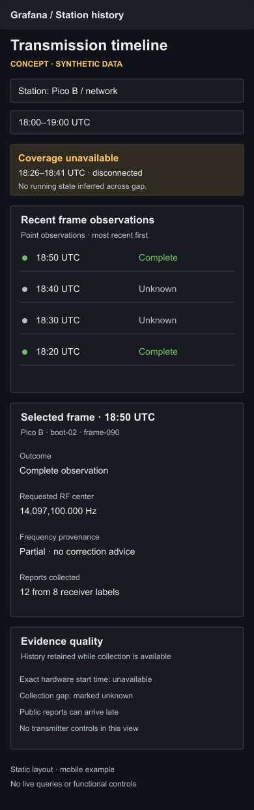

# Shared Pi/Pico transmission history and Grafana plan

## Status and scope

This document proposes an independent station-history and WSPR spot collector feeding PostgreSQL and Grafana. It is a planning document, not an implemented interface or an authorization to deploy services, change logging policies, operate hardware, or transmit. Initial delivery uses existing Pi/Pico observations and public spots, starting with reception charts and then a transmission timeline. No new sensors are required.

The source review used WsprryPi `devel` at `44b7e4c10c252b1d9216ad5e8681a4507b1519af` and WsprryPico `codex/issue-473-device-owned-scheduling` at `05cc90d67442c536f1cf7bee74a94914ad032c23`. Both working trees were clean during inspection. These are planning references, not qualified deployment candidates. Reinspect the intended source pair before implementation; Pico behavior on the inspected side branch must not be described as delivered on `devel`.

## Intended outcome

An operator can compare reception across bands, UTC hours, distances, and directions, then inspect confirmed completed transmissions from each physical transmitter and the public reception reports attributable to their individual WSPR frames. Missing observations, incomplete upstream retrieval, and ambiguous station identity remain visible.

The initial charts describe observed reception. They do not establish receiver availability, decode probability, independent RF accuracy, actual radiated power, antenna gain, or propagation failure from an absence of spots.

### Completed-transmission presentation scope

Grafana transmission records, timeline entries, counts, and transmission drill-downs include only confirmed completed transmissions. Confirmed means supported transmitter-software evidence of successful completion bound unambiguously to a physical executor and execution; it is not independent verification of RF output. Preserve the original source outcome: a presentation state shared by completion and skip is not sufficient. Armed, running, failed, canceled, aborted, skipped, incomplete, and ambiguously bound observations do not appear as transmission rows or contribute to completed counts. A final idle snapshot, elapsed planned duration, or reception spot alone cannot establish completion. Define exact Pi/Pico completion and per-frame confirmation rules in slice A; do not require new producer capabilities implicitly.

Retain only the supporting observations needed to establish completion, deduplicate it, and preserve available accepted callsign/locator, advertised power, mode, frequency/placement, frame bindings, timing, and provenance. A missing exact start or duration does not invalidate otherwise unambiguous completion; show a completion point or explicitly qualified interval. Missing matching context remains unavailable and may prevent spot association without inventing settings. Non-completed attempts are not an initial analytical product; any temporary assembly, contradictory outcome, or quarantine evidence stays bounded under an explicit retention/recovery design. Do not export or retain every progress event or unrelated diagnostic merely because it exists.

Collection health is a separate Grafana view/panel for source availability, backlog/freshness, loss, and coverage gaps. Do not turn unavailable slots into unknown transmission rows or interpret a healthy empty completed list as proof that no attempt occurred. Reception charts may still include retrieved spot-only reports without fabricating local completed records. Completed-only counts are not an attempted-transmission or decode-success denominator.

Calibration evidence stays in a separate logical evidence set, with its own eligibility and retention dependencies. Preserve available execution-bound frequency/correction/reference evidence where approved, but do not require a complete calibration chain for ordinary completed-transmission presentation. Missing calibration evidence prevents correction advice, not an otherwise supported completion. Advisory analysis remains a separate later view/slice, and calibration detail is not required in the initial completion drill-down.

## Feature overview: planned capabilities

The following headlines and descriptions summarize planned end-user capabilities for Wsprry-History. They do not describe implemented or released features. Availability depends on completion of the applicable implementation slices, supported observation access, retained evidence, and their acceptance criteria.

- **See where your signal goes.** Explore reception by band, distance, direction, and receiving station.
- **Find your station's best operating windows.** Discover which bands and UTC hours consistently produce reports. These are observed reception patterns, not guarantees or automatic schedule changes.
- **See your completed transmissions together.** Review confirmed completed Pi and Pico transmissions, their individual WSPR frames, and associated reception reports. Collection health is separate; missing completion evidence does not become a completed transmission.
- **Connect each transmission to its reception reports.** Select a WSPR frame to inspect who heard it, how far it travelled, and its reported signal strength. Unmatched reports and ambiguous associations remain explicit.
- **Follow your station's performance over time.** Compare reception across days and revisit earlier operating periods within the selected retention policy.
- **Spot frequency drift before it becomes a mystery.** Track apparent frequency offsets across receivers and distinguish stable patterns from changing observations. Receiver and propagation effects remain part of the interpretation.
- **Get correction advice backed by evidence.** Eligible manually calibrated configurations can receive advisory suggestions when verified references and sufficient evidence support them. Changes remain under operator control, and ordinary receiver consensus alone does not qualify a suggestion.
- **Know when the picture is incomplete.** Clearly marked collection gaps, delayed reports, and ambiguous matches help prevent misleading conclusions.
- **Keep collecting when the dashboard is closed.** Background collection retains history independently of the browser, subject to source availability and the configured retention policy.
- **Check your station from a desktop or phone.** Planned Grafana views provide a broad reception overview and focused transmission details, with desktop and mobile review included in implementation acceptance.

Reception charts and the observed transmission timeline come first. Frequency advice is a later advisory-only slice, initially limited to selected configurations and single-frame WSPR qualification on 20 m with a 40 m cross-check. The approximately 1 Hz target remains provisional, and no accuracy claim or automatic correction is implied. The detailed scope, eligibility rules, unresolved decisions, and acceptance criteria below govern these descriptions.

## Architecture and ownership

### Selected repository and open deployment choice

The selected repository is `WsprryPi/Wsprry-History`, separate from the Pi and Pico application repositories. It will own the independently testable collector and observation adapters, analytical schemas and migrations, spot matching and advisory analysis, Grafana dashboard definitions, deployment definitions, tests, and its operator documentation. Application-owned producer interfaces remain in their respective repositories. Repository creation is not authorized by this decision and has not been performed as part of this plan.

The deployment choice remains open between a dedicated Linux VM and a spare Raspberry Pi. The exact host, Pi model if applicable, operating-system version, and storage device are not selected. The provisional sizing target is 2 vCPUs for a VM, or comparable available CPU capacity on a Pi, 4 GB RAM, and 100 GB of SSD-backed storage for the colocated collector, PostgreSQL, and Grafana. These are planning resources, not measured requirements or a hardware purchase decision; validate them against actual ingestion, queries, retention, and maintenance headroom. Backup capacity is additional.

The proposed deployment keeps those services on one always-on Linux host, separate from active transmitter execution and browser lifecycle. Service packaging and exact resource limits remain open. A station-side adapter is selected for each enrolled Pi; slice A must resolve its supported observation-export interface, privilege separation, and delivery contract. Selecting the repository or a host class authorizes no deployment, installation, service changes, or implementation.

### Data flow and authority

```text
Pi runtime observations and journal ----+
                                       +--> Station adapter --outbound HTTPS--+
Pico --> existing Pi USB log collector -+                                     |
                                                                             +--> Central collector --> PostgreSQL --> Grafana
wspr.live bounded spot queries ----------------------------------------------+
```

One collector runs on an explicitly selected always-on Linux host, which may be a Pi or a separate computer. Collection is independent of an open browser. The collector observes, normalizes, retains, and associates data; it has no transmission, scheduling, configuration-write, or recovery authority. Database or collector failures must not delay or alter transmitter execution.

Reuse the existing Pi USB-log collection path rather than competing for a Pico Logging port. Read-only network status can support a network-connected Pico, with explicitly lower historical completeness when event records are unavailable. Determine supported observation access and authorization in slice A; an internal socket or browser route is not automatically an external collector API.

### Station-side adapter and outbound delivery

The selected approach uses a small station-side adapter on each enrolled Pi to read permitted local observations and send bounded batches over authenticated outbound HTTPS to the central collector. It runs independently of an open browser. The existing Pi application remains the sole owner of enrolled Pico USB Logging handles, framing, identity checks, maintenance coordination, and collection policy. The history adapter consumes already imported Pico journal records; it does not open Pico Logging, Console, Management, or transmitter-control ports. A central host does not directly read a remote Pi's local journal.

Read-only means no authority to mutate transmitter configuration, schedules, calibration, recovery, service lifecycle, or hardware. The adapter may write its own bounded observation spool and delivery checkpoints. HTTPS batch acknowledgments control history delivery only; they are never device control commands or acknowledgments of transmission success. Central ingestion does not automatically enable logging or enroll new devices. Log collection that is disabled or unsupported produces an explicit unavailable source, not an automatic settings change.

| Source | Planned access | Limit |
| --- | --- | --- |
| Native Pi application journal | Local reader with fixed application/unit and field allowlists, preserving original origin metadata, journal cursor, event time, and receipt time | Existing text does not establish every accepted execution field; missing context remains unavailable |
| Imported Pico USB logs | The same journal path, retaining the Pico origin and the Pi collector/receipt evidence | No competing USB handle or direct Pico control access; origin claims retain their existing trust classification |
| Pi runtime and accepted execution context | Dedicated application-owned read-only runtime export, consumed by the local helper | Planned interface, not an existing collector API; field allowlists, authorization, and snapshot/replay/recovery details remain open |
| Pico accepted-job/status context | Supported Pi-mediated observations where available | No invented job bindings or substitution of current settings for earlier accepted settings |
| Network-only Pico | A separately scoped read-only status adapter when needed | Polling offers reduced history; direct network-Pico authentication and access remain design work, not resolved by station HTTPS delivery |

The inspected Pi local event transport admits backend or web-service UIDs, and the web-service identity has broader browser/HTTP capabilities. Do not run the history adapter as either identity or grant it their access as a shortcut. Access to the event socket is not made safe merely by having a client request only reads. If a new observation-only export or role is necessary, identify and review that application change explicitly within the existing coordinated interface gates. Reuse of existing observations does not mean that every required access boundary already exists.

Separate a minimal local reader/helper from the unprivileged network forwarder. Any journal-read privilege belongs only to the local reader; it has no outbound network role and exposes only fixed, bounded observations. The forwarder accesses only those exported records, its own spool/checkpoints, and scoped ingestion credentials. Neither component receives generic shell execution, sudo commands, service-management authority, GPIO access, Pico control access, or private application database/pairing-key access. A journal unit filter is an output filter, not proof of unit-scoped operating-system read permission; slice A must document any broader journal-read privilege and its containment. The helper-to-forwarder default is the local observation interface below; exact authorization and sandbox policy remain open.

The central collector authenticates each enrolled station and permits ingestion only for that station's explicitly associated Pi/Pico origins. Station authentication does not convert a forwarded Pico claim into cryptographic Pico authentication. Central responses cannot supply shell commands, arbitrary file paths, journal filters, control requests, or remote reconfiguration. No inbound station listener or general remote-command channel is part of this approach. The initial authentication default is one opaque ingestion token per station forwarder over verified HTTPS, with administrator-controlled enrollment and overlapping rotation. Certificate trust, credential storage, and provisioning use the selected planning defaults below; the DNS name, renewal tooling, supported OS, recovery procedures, and Pico reassignment remain open. A station credential must not grant direct database administration or Grafana administration.

Proposed delivery requirements:

- Persist observations in the station spool before advancing the corresponding source-read checkpoint. Preserve journal cursors and origin/boot/sequence separately; distinguish filtered sequence gaps from positively observed loss.
- Acknowledge a batch centrally only after its observations and deduplication/checkpoint state are durably committed. Retry unacknowledged delivery with bounded backoff and idempotent deduplication; lost responses must not inflate history or counts.
- Release acknowledged spool records according to the agreed delivery contract. A local enqueue or network write is not proof of central retention.
- Collector outages, slow responses, and database backpressure cannot block RF execution or the existing Pi USB collector. The provisional queue and delivery defaults below require validation; their storage format, exact resource enforcement, and failure transactions remain engineering decisions.
- Recover journal entries only while they remain retained. Runtime events are bounded and not a durable archive; boot changes, event-feed resynchronization, journal rotation, spool overflow, and missing sources produce explicit coverage gaps. A fresh snapshot establishes current state, not missed start/completion history.
- Document trust, identity, source completeness, and receipt-time provenance on both sides of the transport. Source truncation or unavailable replay cannot be concealed by successful batch delivery.

The adapter, its spool, and the central ingestion service belong to the selected Wsprry-History repository; application-owned export changes stay in WsprryPi or WsprryPico. This is an architecture decision only. Queue values below are provisional planning defaults; authentication lifecycle defaults still require implementation validation, and the observation-export defaults below still require detailed contract design and validation; remaining engineering choices and implementation/deployment remain unapproved or unresolved as recorded below.

### Observation-export interface defaults

Use one local observation interface for the station adapter, backed by a dedicated application-owned read-only Pi runtime export and a filtered reader of existing native Pi/imported Pico journal records. These are selected planning defaults, not implemented interfaces or authorization to change producer protocols. Application-owned export changes remain in WsprryPi, with affected companion contracts reviewed and validated under the coordinated interface gates; the helper and history adapter belong to Wsprry-History.

The network forwarder receives only approved observations from the minimal local helper through a filesystem Unix-domain socket. Use the separate service identities, restrictive directory/socket permissions, and peer-credential checks specified in the local authorization defaults below; exact names/paths, journal privileges, socket lifecycle, framing/limits, and systemd controls remain open. Proposed operations are limited to interface/source capability discovery, bounded reads after an opaque position, and approved current-state snapshots. No caller-supplied journal filters, arbitrary paths, SQL, generic command dispatch, or mutation operations are permitted. The forwarder has no application-control socket, database, journal-file, or Pico USB access. Only the helper has the selected journal-read privilege; it has no outbound network role or station ingestion token. Document and contain any broader OS journal access rather than treating an output filter as a permission boundary.

The Pi runtime producer must expose a separate narrowly authorized observation endpoint, rather than granting the helper backend or web-service identity. Export only the minimum approved completion evidence and supporting runtime/accepted execution context needed by the completed-transmission scope: executor/boot identity, job/frame bindings, observed outcome, mode/frequency fields, backend/profile, and correction provenance where actually available. Missing historical or accepted context stays unavailable. Do not substitute current saved settings for accepted execution settings, dump the diagnostic settings export, or read private application storage. Exact field allowlists, endpoint authorization, and producer-side schema remain open.

For journals, allowlist the trusted producing unit/process context and approved schema, ingress, origin, event, and field combinations. Preserve available native Pi and imported Pico origin/boot/sequence, monotonic and UTC timestamps, collecting Pi/profile, receipt time, drop evidence, and opaque journal cursor. Application-supplied origin fields retain their existing trust classification; a trusted journal producer is not cryptographic proof of Pico identity. Select approved bounded message content explicitly, excluding secrets and unrelated diagnostics. Do not inherit UDP-forwarding event restrictions automatically: history may need accepted ARM context that is not exported over UDP, but its exact event/field allowlist requires review. Never open an additional Pico port or enable logging automatically.

Use an independently versioned, bounded observation envelope with strict shape/type validation, parser/source version, source identity, receipt provenance, and explicit missing-field or unavailable-source reasons. Keep source identity, assignment identity, and delivery identity distinct. Preserve exact timestamp precision and original approved evidence needed for deduplication/reprocessing; raw evidence means allowlisted bounded source content, not unrestricted log forwarding. Unknown schemas or malformed/oversized records must produce a bounded refusal/quarantine or coverage indication under the recovery design, never silent truncation or inferred success. The bounded-contract defaults below select framing, trial ceilings, strict validation, and rejection behavior; exact schemas, field-specific bounds, extension rules, and detailed malformed-record recovery remain open.

Runtime event reads are bounded live observations, not a durable replay archive. Detect boot changes, overrun, and resynchronization; obtain an approved current snapshot while explicitly recording the unavailable interval. Where supported, bind snapshots to an event watermark so startup and reconnect do not hide races; watermark consistency and replay ordering remain design decisions. Do not promise lossless recovery or infer missed execution from a snapshot. Journal replay is limited to retained entries: treat cursors as opaque, verify exact cursor recovery, and report missing positions rather than silently accepting the nearest available entry as complete replay. The replay and recovery defaults below select initial lookback and checkpoint ownership; exact event-read/snapshot cadences and source reconciliation mechanics remain open; the existing five-minute retained unchanged-state checkpoint default does not establish a safe live-event polling interval.

Persist exported observations into the existing bounded station spool before advancing the corresponding source-read checkpoint. The local read position is separate from central durable-delivery acknowledgment; neither the helper nor producer requires a new unbounded archive. Startup, crashes, rotation, missing cursors, source refusal, and slow consumers must preserve explicit coverage and must not block the transmitter or existing USB collector. The forwarder owns durable source checkpoints as specified below; atomic handoff implementation and detailed restart/replay and recovery protocols remain open. This interface operates without a browser and does not expand network-only Pico access.

### Bounded observation-export contract defaults

These are planning defaults for the new local observation interface, not implemented wire formats or authorization to change existing Pi/Pico transports. All numeric ceilings, concurrency, and deadline values below are **trial defaults** to qualify against representative fixtures on the supported OS. Export only approved confirmed-completion evidence and minimal supporting context, separate collection health, and separately approved calibration evidence.

| Contract property | Trial default |
| --- | --- |
| Local framing | Four-byte length prefix followed by one UTF-8 JSON document |
| Request ceiling | 8 KiB |
| Individual observation ceiling | 16 KiB, including approved source evidence and its observation envelope |
| Complete read-response ceiling | 128 KiB, including response envelope, continuation, status, and rejection items |
| Page count | At most 32 observation/rejection items, stopping earlier at the byte ceiling |
| Snapshot ceiling | Same 128 KiB complete-response ceiling, with bounded fields and collection sizes |
| Continuation ceiling | 4 KiB |
| JSON nesting ceiling | 16 levels |
| Read concurrency | One outstanding read per source per forwarder |
| Request deadline | Five seconds; return promptly with available data |

Use binary KiB units. Measure serialized UTF-8 bytes, including JSON escaping and envelopes; include the fixed framing header in request/response wire ceilings. No compression, arbitrary blobs, or record fragmentation initially. These limits are independent of existing Pi/Pico protocol limits and the separate station-to-central HTTPS batch limits. An oversized eligible observation becomes explicit bounded rejection/loss evidence, never a truncated apparently valid record. Exact per-field bounds, snapshot collection limits, and scan-work budgets remain open.

Use a named observation schema/version independent of shared control protocols, HTTPS authentication, and analytical storage. Define closed schemas for requests, responses, and each observation type. Validate document shape before field access; reject duplicate keys, missing/extra fields, wrong types, unsupported versions, and unknown operations. Enforce field-specific lengths, ranges, units, collection bounds, and cross-field consistency among source kind, origin, boot, event, execution binding, and provenance. Represent unavailable values explicitly rather than substituting zero. Use canonical decimal strings for nanosecond timestamps and potentially large counters to preserve exact integer precision. Approved original evidence counts toward the observation ceiling and is allowlisted content, not unrestricted message text.

Capability discovery reports the supported observation schema and limits. An incompatible peer exposes an unavailable-source fault rather than relaxing validation or silently selecting an older contract. Exact schema names, payload layouts, extension rules, and capability validation remain engineering decisions; this plan does not introduce a new shared Pi/Pico control version.

Each read response distinguishes its continuation, observed source head, whether more data is currently available, and coverage status such as complete traversal, resynchronization required, or known loss. Complete traversal describes only the selected source/window, not proof of every physical transmission. Advance continuation only through source entries actually examined. Every eligible entry passed must be represented by its observation or explicit rejection/loss item in the response. A page containing only intentionally excluded entries may advance traversal under the recorded allowlist policy; an empty page is not evidence that no transmissions occurred. Exact scan-work and filtered-only-page progress bounds remain open.

Continuations are opaque to the forwarder and bound to source identity, applicable source epoch/boot, and policy revision. Validate them against current authorization; they cannot grant broader reads or become caller-selected journal queries. Persist a continuation only atomically with its observations and rejection/loss decisions. It should survive helper restart where the underlying source and policy remain valid. Runtime producer restart invalidates that runtime position without automatically invalidating a retained journal cursor. Missing journal positions use the recovery procedure below, including exact cursor verification. Exact continuation encoding, integrity checks, validation, and recovery representation remain open.

| Rejection condition | Planning default |
| --- | --- |
| Unauthorized peer or operation | Refuse before reading; no continuation advancement |
| Malformed request, unsupported schema, or invalid position | Bounded error; no silent reset or advancement |
| Temporarily unavailable source | Retryable source status; preserve its checkpoint |
| Missing cursor or runtime overrun | Explicit resynchronization/coverage response |
| Eligible source observation malformed or oversized | Bounded rejection item with source position, reason, and safe provenance |
| Forwarder cannot validate the response | Reject the page and preserve the previous durable checkpoint |

A source rejection permits progress only after its rejection/loss decision is durably retained locally. It is neither a retained completed transmission nor a central-delivery acknowledgment. Return fixed reason codes and safe identifiers; do not echo arbitrary rejected payloads, credentials, or unbounded parser messages. Optional payload quarantine must be sanitized and bounded within the existing reserved queue budget; retain loss metadata when payload retention is inappropriate. If rejection bookkeeping cannot be persisted, stop the affected source checkpoint while other sources may continue. Exact retryable/permanent codes, quarantine allocation, sanitization, and recovery responses remain open.

### Observation replay and recovery defaults

These are selected planning defaults for slice A contract design and slice C qualification, not implemented replay or recovery behavior. They preserve confirmed-completion evidence, separate collection health, and independent calibration eligibility. They authorize no changes to journal retention, logging policy, services, or devices.

| Startup or recovery situation | Planning default |
| --- | --- |
| First enrollment without a checkpoint | Replay the last **24 hours as a trial initial lookback**, limited to permitted retained journal observations, assignment authorization, and queue capacity |
| Normal restart with a valid checkpoint | Resume immediately after the last durably spooled source position; do not replace an exact checkpoint with a fresh time lookback |
| Runtime producer restart, overrun, or unavailable events | Record a coverage gap, establish a new snapshot/event baseline, and reconcile available journal evidence |
| History outside automatic bounds | Require an explicit bounded historical import; do not silently expand replay |

Earlier history is outside the initial collection window, not evidence that nothing transmitted. Start live observation promptly while historical replay proceeds, with separate positions until reconciliation completes and deduplication of overlap. Historical replay must not consume all capacity and cause avoidable live-event loss; exact scheduling and resource allocation remain open. Read bounded Pico terminal history promptly where the approved export makes it available, rather than waiting for journal backfill to finish. Retention limits and unavailable source evidence remain explicit.

Prefer a producer operation returning a consistent snapshot and associated event watermark scoped to the producer boot/session. Durably retain the approved snapshot context, then consume events after that watermark. Advance only through events actually returned and durably spooled, never directly to the advertised stream head. Snapshot state must be consistent with its watermark; separate snapshot and head reads do not establish this guarantee. This is a proposed producer contract, not an existing-interface guarantee. If a consistent operation is impractical, bracket the snapshot with event reads, retain overlap, and expose any ordering uncertainty rather than claiming a seamless handoff. Exact consistency, bracketing, and replay ordering mechanisms remain open.

Only explicit, unambiguously execution-bound completion evidence creates a completed record. Idle state, ARM acceptance, a planned end time, or a reception report cannot establish completion. A confirmed completion without a known start remains a completion point without invented duration. Current snapshots cannot provide settings for a different historical execution. Snapshot recovery and journal reconciliation do not close coverage gaps without supporting evidence.

The forwarder's durable spool store is the sole owner of persistent source checkpoints. The helper owns journal handles and transient read positions and returns observations with bounded continuation positions. Commit approved observations and the corresponding source checkpoint atomically in the local store before requesting the next page. The central collector independently commits observations and delivery deduplication before acknowledgment; helper reads, local retention, and central delivery are distinct. Neither producer nor helper needs a new unbounded archive.

Maintain separate checkpoints for journal traversal and each runtime producer boot/session. Keep source positions separate from Pico event identities, assignment identities, and HTTPS delivery IDs. Persist the allowlist/parser policy revision with checkpoints; traversing an excluded record under one policy does not establish that an expanded policy has collected its evidence. Reprocessing after policy changes requires an explicit bounded decision. Exact continuation representation, checkpoint transaction implementation, and filtered-record progress semantics remain open.

Treat journal cursors as opaque and verify the exact recovered entry after seeking; a nearest available entry is not successful exact replay. Preserve a missing checkpoint and durably record a recovery/coverage incident. Attempt bounded replay from **10 minutes before the last durably recorded journal receipt time as a trial overlap**, limited to observations within the existing seven-day queue-age policy and available authorized retention. Deduplicate replay, and establish a new checkpoint only through durable ingestion or an explicitly recorded loss decision. Keep unrecoverable intervals visible in collection health. The ten-minute margin does not guarantee recovery across clock changes; when receipt-time ordering is unreliable, use available boot/monotonic evidence or a conservative bounded scan and retain uncertainty. Exact scan strategy and bounds remain open.

Missing cursors must not block unrelated live sources indefinitely or silently jump the affected source to now with a claim of completeness. Malformed or permanently rejected observations require bounded quarantine or a durable discard/loss decision before moving past them. If the necessary bookkeeping cannot be persisted, stop advancing the affected source checkpoint while other sources may continue. Keep detailed quarantine limits, recovery responses, replay resource allocation, and snapshot/read cadences open; the existing five-minute retained unchanged-state checkpoint default is not a safe live-event polling interval by itself.

### Local observation authorization defaults

These are planning defaults for the dedicated observation path, not implemented accounts, permissions, or service hardening. Use two separate fixed, non-login service identities: one for the minimal local reader/helper and one for the network forwarder. Resolve the configured accounts to numeric UIDs and fail closed if they are absent or conflict. Do not reuse root, backend, web-service, or interactive operator identity, and do not grant sudo, application administration, hardware groups, pairing keys, or transmitter service-management authority. Exact account/group names remain open; `wsprry-history-reader` and `wsprry-history-forwarder` are illustrative names only. Local root remains trusted; this boundary does not protect against a compromised administrator.

Only the helper receives the journal-read privileges required by the selected journal arrangement. The forwarder receives no journal membership or journal-file access, and the helper receives no station HTTPS token or outbound network role. A unit/field filter constrains exported output but does not narrow underlying OS journal permissions. Select and document actual journal privileges and containment explicitly; do not assume unit-scoped read access exists or run the helper as root as a shortcut. The forwarder's own spool/checkpoints and systemd-delivered HTTPS credential remain separate from helper access.

Use two distinct filesystem Unix-domain endpoints in protected runtime directories, separate from the existing control/browser socket directory:

| Endpoint | Planning default |
| --- | --- |
| Pi producer to helper | Producer-owned observation listener, directory mode `0750` and socket mode `0660`, with a dedicated client group permitting helper access only |
| Helper to forwarder | Helper-service-owned observation listener, directory mode `0750` and socket mode `0660`, with a separate dedicated client group permitting forwarder access only |

The directory owner is the trusted listener service or service manager according to the selected lifecycle design; client identities have no directory write permission and cannot replace listener paths. Exact paths, account/group names, ownership mechanics, socket activation, creation/recreation, and stale-socket removal remain open. Provision memberships narrowly and validate actual access, including incidental groups; do not grant the forwarder access to the producer endpoint or either client access to other application sockets. Protect parent directories, reject unexpected ownership/type or symlink substitution, and do not repair suspicious paths by blindly unlinking them.

Use filesystem permissions plus kernel peer-credential checks on each accepted connection. The producer authorizes only the selected helper UID; the helper authorizes only the selected forwarder UID. Clients verify the expected server peer identity and protected endpoint path. Do not authorize by hostname, PID alone, group membership alone, or JSON-supplied identity. Credential or permission mismatches cause refusal and a collection-health fault, not an insecure fallback. If socket activation is selected, explicitly validate peer-credential semantics for service-manager-created listeners rather than assuming they identify the eventual service process; precise expected identities and lifecycle checks remain engineering decisions.

The producer observation endpoint uses its own closed dispatcher permitting only capability/schema discovery, bounded observation reads, and approved current-state snapshots needed for collection recovery. It has no generic control-operation passthrough, caller-selected filters, arbitrary paths, diagnostic/settings dump, or mutation route. Preserve completed-transmission-only presentation, minimal supporting context, separate collection health, and separately identified calibration evidence. A disconnected, overrun, or slow reader must not block transmitter execution or existing USB collection. This endpoint does not grant new access to a network-only Pico or an additional USB handle.

For the helper, the hardening defaults are no outbound networking, only `AF_UNIX` socket creation, no privilege escalation, an empty capability set, private device access, and filesystem exposure limited to required observation sources and runtime paths. For the forwarder, permit required HTTPS/DNS connectivity and its spool/credential while excluding journal, producer/control socket, private database, and hardware access. Exact systemd directives, namespace visibility, inherited descriptors, writable state paths, and supported OS controls remain open and require qualification. A read-only mount does not prevent connecting to a Unix-domain socket; use permissions, endpoint authorization, and explicit path isolation together. Do not weaken the existing transmitter service sandbox to accommodate the observer.

### Station authentication, enrollment, rotation, and revocation defaults

These are selected initial design defaults for a small station fleet, not implemented credentials or qualified lifecycle behavior. They authorize no credential issuance, enrollment, repository creation, or deployment. Keep station-to-collector ingestion separate from Pi/Pico control authentication, observation-export authorization, database administration, and Grafana login.

| Authentication property | Initial default |
| --- | --- |
| Credential | One cryptographically random 256-bit opaque ingestion token per station forwarder, with a non-secret key ID; overlapping rotation permits a temporary replacement token |
| Scope | Ingestion only for the enrolled station and its explicitly approved Pi/Pico origin list |
| Transport | Authorization: Bearer header over HTTPS; no token in URLs, request bodies, diagnostic logs, command-line arguments, source control, or mockups |
| Station protection | Root-owned `0700` directory and `0600` token source file, delivered to the unprivileged forwarder through systemd `LoadCredential=`; no token access for the journal reader/helper |
| Central protection | Store SHA-256 token digests and lifecycle metadata, indexed by non-secret key ID, with constant-time digest comparison; no recoverable plaintext tokens |
| Administration | Separate administrator authority; station tokens cannot issue/rotate credentials, enroll origins, change policy, query history, or administer Grafana/database state |
| Server identity | Validate certificate chain, hostname, and validity; never bypass validation or fall back to plaintext HTTP |
| Redirects | Do not automatically follow ingestion redirects or forward credentials to another host |

Enrollment is explicit and administrator-controlled. Create a station record with stable identity and display name, approve native Pi and individual Pico origins, generate a scoped token, and provision it through a trusted administrative channel. Confirm the first authenticated durable upload against the expected station and permitted origins. Record the enrolling administrator, enrollment time, key ID, and origin authorization. Token possession authenticates the forwarder; supplied station identity is not independent proof that it owns a physical Pi/Pico. Define identity-verification evidence before enrollment implementation.

Discovery never expands an origin allowlist automatically. Hostname changes do not change stable identity or require re-enrollment by themselves. Changed machine identity and cloned/conflicting identities require administrator review. A moved Pico requires explicit administrator reassignment under the planning defaults below. Preserve historical authorization periods and origin ownership; discovery cannot authorize a move. Assignment-boundary representation, backlog evidence, and deduplication engineering remain open.

| Lifecycle policy | Initial default |
| --- | --- |
| Token lifetime | 90 days from issuance, enforced centrally |
| Routine rotation | Begin around day 60 through separate administrator authority |
| Expiry warning | 14 days before expiry |
| Old/new overlap | At most seven days, bounded by each token's own expiry; beginning rotation does not extend the old token |
| Old-token retirement | Revoke after a durable batch is confirmed under the replacement token, or when the overlap ends, whichever occurs first |

These intervals are operational defaults requiring acceptance validation, not externally mandated standards. Provision a replacement atomically and reload it without restarting the transmitter. Retain the previous station-side credential only for the explicitly defined overlap/recovery procedure, then remove it. The station forwarder receives no credential-issuance privilege. An offline station that misses expiry does not receive automatic grace; it queues within the existing capacity/age policy and requires authorized credential recovery. The provisioning and credential-loading defaults below select manual SSH enrollment and a history-forwarder-only restart; exact tooling, rollback during overlap, and secret-removal procedures remain open.

Rotation changes the delivery credential, not the identity or timestamps of queued observations. Preserve original station/Pico origins, boot/sequence, and stable delivery identities when retrying under a replacement token. Record the authenticating key ID separately from origin identity. A replay after credential replacement must not duplicate history or make an old observation appear freshly generated. Administrator changes to origin authorization remain distinct from routine token rotation.

Provide separate revocation operations: revoke an individual key, or disable a station and reject all of its keys. Recheck authentication, expiry, station enablement, and origin authorization on every batch; initially avoid long-lived authorization caches. Define atomic ordering between revocation and an in-flight durable commit, including what a lost acknowledgment means. A batch committed before revocation remains historical; a request ordered after effective revocation cannot gain ingestion authority from an earlier connection check.

Authentication rejection or certificate-validation failure suspends delivery, exposes an actionable fault, and retains queued observations subject to queue bounds. No bypass, automatic new enrollment, transmitter/configuration change, or continual rapid retry is permitted. Recovery requires the selected trusted credential or certificate procedure. Invalid credentials and operational faults must be observable without revealing secrets; log key IDs and reasons, not token contents or authorization headers.

Revocation stops subsequent authorized ingestion; it does not prove that previously accepted observations were genuine. Retain station/key provenance so suspected-compromise intervals can be flagged and excluded from calibration advice without silently deleting history. The incident-marking and review policy remains to be specified. Historical data and retained deduplication bindings must not be reassigned to a replacement credential or station to bypass a refusal.

Certificate trust, credential storage, and provisioning use the selected planning defaults below; they are not implemented or qualified behavior. The DNS name, renewal tooling, supported OS/systemd baseline, and detailed recovery procedures remain open. Pico reassignment remains a separate authorization decision. Mutual TLS remains optional later work. This plan stores no actual tokens, CA keys, or provisioning secrets.

### Certificate trust, credential storage, and provisioning defaults

Use a stable collector DNS name under an administrator-controlled domain, independent of whether the collector runs on a VM or spare Pi. The default is an automatically renewed public CA certificate with DNS-01 validation, permitting a LAN/VPN-only collector without public ingress for certificate validation. Keep narrowly scoped DNS automation credentials centrally, never on station adapters. The exact DNS name, reachability arrangement, DNS provider, ACME client, and renewal tooling remain open. If domain ownership or automated DNS validation is impractical, select a deliberately provisioned private CA instead; distribute its public trust anchor through the trusted administrative channel and scope it to the adapter where supported. This is an explicit deployment choice, not an automatic fallback.

Stations use the maintained operating-system CA store for public CA trust and verify the server certificate chain, hostname, and validity dates. Prefer TLS 1.3, with TLS 1.2 as the minimum; do not pin individual server certificates. Monitor certificate renewal and expiry. Certificate-validation or clock-validity failures pause delivery, expose an actionable fault, and retain observations within the existing queue limits; never disable verification or fetch a private trust anchor from an unverified collector to recover. Trust-anchor rollover, clock recovery, and renewal-failure procedures remain open.

The station default is a root-owned credential directory with mode `0700` and token source file with mode `0600`, delivered to the unprivileged history forwarder through systemd `LoadCredential=`. Only the administrator and forwarder receive the secret; the local reader and Pico devices do not. Keep token values out of environment variables, command arguments, ordinary configuration, logs, and Git. The initial baseline uses a protected-file source without requiring TPM-bound encryption; encrypted systemd credentials remain a later option after selecting supported OS/systemd versions and recovery procedures. A different credential mechanism requires an explicit design decision rather than an automatic fallback.

The collector stores a SHA-256 digest of each cryptographically random 256-bit token, indexed by its non-secret key ID, alongside station/origin scope, expiry, and revocation metadata. Compare digests in constant time. Provision a newly generated token once; the stored digest cannot recover its plaintext, and loss requires replacement. Keep station ingestion tokens out of routine backups by default, back up non-secret station identity/configuration separately, and issue a fresh token during restoration or station replacement. Exact backup handling, secret removal, and recovery procedures remain open.

Use manual administrator-controlled enrollment initially, supported by a repeatable administrative tool whose commands and implementation remain open:

1. Create the stable station record and explicitly approve its Pi/Pico origins using separate administrator authority.
2. Generate the station-scoped token and verify the destination station's SSH host identity through a trusted process.
3. Transfer the secret through protected input over SSH and install it in the protected credential file, without putting its value in command arguments, terminal output, shell history, or logs. Provision any required private CA trust anchor through this trusted channel.
4. Verify collector HTTPS identity before transmitting the token, start only the history forwarder, and confirm a durable upload under the expected station and key ID.
5. Remove temporary secret material and retain non-secret enrollment/audit metadata. Unattended self-enrollment is outside the initial slice.

For rotation, atomically replace the credential source and restart only the history forwarder to load the new systemd credential; source-file replacement alone does not refresh a running service's credential. Preserve the durable queue, checkpoints, observation origins, and delivery IDs. Confirm durable delivery under the replacement key, then retire the old key under the selected overlap policy. This administrator provisioning procedure does not grant the adapter service-management authority and must not restart the transmitter or existing USB collector. Exact restart-failure, rollback, lost-token, station-replacement, and trust-recovery procedures remain open.

These choices follow [Let's Encrypt DNS-01 guidance](https://letsencrypt.org/docs/challenge-types/), [OWASP TLS guidance](https://cheatsheetseries.owasp.org/cheatsheets/Transport_Layer_Security_Cheat_Sheet.html), and [systemd credential documentation](https://www.freedesktop.org/software/systemd/man/latest/systemd.exec). Qualification must use the selected deployment OS and tooling, rather than assuming current upstream documentation proves support on every station.

### Pico reassignment, backlog-drain, and deduplication defaults

These are selected planning defaults, not implemented reassignment or qualified identity guarantees. Keep the physical Pico origin, the collecting Pi station, and their administrator-approved assignment as separate identities. Preserve the Pico origin across moves; give each assignment its own ID and recorded boundaries. A USB identity remains observed identity, not cryptographic device authentication. Collection assignment is separate from callsign, location, and calibration context; a move does not establish those settings automatically.

Use non-overlapping ongoing collection authority. For a normal move, an administrator confirms the Pico identity and destination Pi, allows the former station to finish uploading where practical, and records its last observed Pico boot/sequence boundary. Atomically close the old assignment and activate the new one centrally, then confirm an accepted destination-station observation. A return move creates a new assignment rather than reopening an old one. Do not transfer tokens or require token rotation solely because of reassignment. Check token validity, station enablement, and the applicable ongoing-collection or historical-drain authorization on every batch. No reassignment operation authorizes Pico configuration changes, transmitter/service actions, or automatic discovery enrollment.

The former station may drain eligible queued observations for a **trial seven-day window after reassignment**, subject to the existing queue age and capacity limits. The drain deadline does not extend queue retention or refresh observation age. This window is independent of credential-rotation overlap, even though both initially use seven days. Closing ongoing collection authority preserves only the explicitly bounded historical-drain permission; revoked/expired credentials or a disabled station remain blocked.

| Former-station submission | Planning default |
| --- | --- |
| Clearly within its closed assignment | Accept during its drain window, subject to valid credentials and applicable origin authorization |
| Clearly collected after its assignment closed | Reject; the drain permission does not allow continued collection |
| Assignment boundary cannot be established | Hold for explicit administrator review within bounded quarantine/recovery rules |
| Drain window expired | Require a specifically authorized bounded import; do not reopen ongoing collection authority |

Preserve original collecting station, assignment, source timestamps, receipt provenance, and stable delivery IDs. Prefer a source boot/sequence boundary and, where practical, a centrally registered manifest of pending observation identities before transfer. These bound a claim but do not prove authenticity; claimed UTC alone is insufficient when clocks or station trust are uncertain. If the former station is offline, permit the new assignment to proceed and leave ambiguous old backlog unresolved. An import exception must identify specific bounded records and cannot bypass credential revocation or station disablement. An unresolved record must not silently disappear or block unrelated accepted history; exact per-record responses and recovery semantics remain open.

Deduplicate delivery retries, Pico source events, and derived transmissions separately:

- Delivery retries use a persistent adapter identity plus stable record ID, preserved across restart, rebatching, and credential rotation.
- The candidate Pico source-event key is Pico origin, boot identity, stream/event namespace, and origin sequence. Slice A must verify actual uniqueness, reset, and reuse semantics before selecting this key. Exclude collecting station, assignment, and token from the source-event key so the same event forwarded through two authorized paths cannot inflate source-event counts; preserve both delivery/receipt provenance records.
- Reconcile distinct observations into a derived transmission only through explicit execution/job bindings. Missing bindings remain unresolved rather than being merged by similar text or nearby timestamps.

For an identical source-event identity and identical original source content, retain one source event with multiple authorized delivery receipts. Different original source content under that identity is a visible conflict, never a silent overwrite; observer-added metadata is compared separately. Where source identity is insufficient, retain unresolved observations instead of claiming deduplication. Authorization precedes duplicate acknowledgment: knowing an existing event ID does not authorize submission or probing. Database uniqueness enforcement must handle concurrent ingestion without replacing authorization checks.

Retain compact deduplication records through every permitted replay window, including when raw payloads expire. Expired drain authority prevents reintroduction after deduplication records are removed; a bounded-import exception must explicitly account for expired deduplication evidence. Retention, identity/content comparison, and exception handling must be designed together rather than assuming old imports remain safely deduplicable forever.

Treat a move as a new calibration-context epoch and invalidate current correction advice. Preserve historical results, but require fresh eligible evidence for advice in the new context. Ambiguous or conflicting assignment evidence blocks affected calibration advice; a recent backlog upload cannot make old evidence fresh.

Remaining engineering choices include the verified Pico source-event key, assignment-boundary representation across boots or uncertain clocks, backlog-manifest format and registration, bounded-import approval and quarantine procedures, identity/content comparison, deduplication-record retention, and atomic ordering of reassignment, authorization, and concurrent ingestion. These choices require slice A design and slice C acceptance before deployment.

### Provisional station queue, batching, and outage defaults

These are provisional defaults to validate during design and slice C acceptance, not measured capacity guarantees or authorization to change a station. The station queue holds permitted Pi observations and imported Pico logs only. Public WSPR spots are fetched centrally and do not consume this station-side queue. A queue budget applies per station Pi across all its enrolled origins, not separately to each attached Pico.

| Queue policy | Provisional default |
| --- | --- |
| Total persistent queue budget | 512 MiB per station Pi, including storage-engine and bookkeeping overhead |
| Ordinary queued observations | Up to 448 MiB within the total budget |
| Reserved budget | 64 MiB within the total budget for bookkeeping, loss records, bounded quarantine, and storage-engine overhead; exact subdivisions remain open |
| Unacknowledged age limit | Seven days, subject to earlier byte-limit or low-disk handling; this is delivery retention, not central archival retention |
| Usage indicators | Warning at 75% and critical at 90% of the total budget; also report ordinary-observation budget pressure separately |
| Filesystem protection | Suspend ordinary queue growth below 1 GiB available on the queue filesystem; reserve/recovery enforcement remains to be designed |
| Outage qualification target | 72 hours of central unavailability at the measured enrolled-station workload, including agreed headroom |
| Unchanged-state checkpoint | Every five minutes, plus relevant state-change observations; preserve execution/correction context required by retained frames |

Use MiB/GiB as binary units for queue limits: 1 MiB = 1,048,576 bytes and 1 GiB = 1,073,741,824 bytes. The existing central-history estimate of 5–15 KB per frame is only a rough planning proxy for queue demand, not a measured spool record size. At 720 frames/day and the 15 KB assumption, three executors produce approximately 32.4 MB/day of frame history and eight produce 86.4 MB/day, before extra idle/status/debug traffic or different queue overhead. These examples support evaluating a 512 MiB starting budget but do not prove 72-hour outage coverage. Measure native and imported-Pico volume, including debug/GPS policy where enabled, before accepting the allocation. Per-origin fairness and noisy-source limits remain open.

Prioritize completion evidence and the minimal accepted context needed to assemble completed records, identity changes, and coverage gaps. Preserve available calibration context separately under its evidence policy; forwarding every lifecycle/progress observation or retaining failed attempts is not required. Coalesce redundant unchanged polls instead of retaining every poll indefinitely. A five-minute checkpoint is a current-state observation, not evidence of unobserved transitions. Required context must survive any coalescing decision. Reclaim acknowledged records; the local queue is not an additional long-term archive or a promise to retain every raw poll for the central 7–30-day policy.

| Delivery policy | Provisional default |
| --- | --- |
| Normal send trigger | Oldest ready unsent record reaches two seconds, or a batch limit is reached |
| Batch bound | 256 records or 256 KiB of uncompressed serialized request body, whichever comes first, including envelope overhead |
| Concurrent uploads | One per station adapter |
| Connection timeout | Five seconds, bounded by the whole-request deadline |
| Whole-request deadline | 15 seconds |
| Catch-up rate | At most 1 MiB/second of uncompressed request-body data per station, additionally bounded by central admission |
| Delivery order | Oldest first with fairness across origins and preserved per-source ordering; exact catch-up/health scheduling remains open |
| Transient retry | Randomized exponential backoff beginning around one second and growing to a 60-second maximum local backoff; honor valid longer server Retry-After instructions |

The send trigger is a scheduling target while connected and admitted, not a two-second end-to-end latency guarantee. Persist stable delivery identities and keep unacknowledged observations across process restart. A central acknowledgment must bind the accepted batch/records and mean durable central storage, not merely HTTP receipt. Lost acknowledgments trigger replay and deduplication, never inflated history or premature queue deletion. Per-record limits, compression policy, acknowledgment shape, oversize-record treatment, and storage/checkpoint formats remain open. Do not truncate observations silently to meet a batch limit.

Provisional outage and failure behavior:

- Network/central failures leave collection running locally while capacity permits, with bounded retry and no transmitter or USB-collector backpressure.
- Central overload honors valid Retry-After instructions and reports the delayed state. Define malformed/excessive-header handling without creating a tight retry loop or bypassing admission.
- Authentication rejection or certificate-validation failure suspends delivery and surfaces an actionable fault while queued data remains subject to capacity/age limits. Never disable certificate validation. The lifecycle defaults above apply; exact credential reload/recovery and retry classification remain design work.
- Permanently rejected records enter a bounded quarantine with an inspectable reason. Define an explicit rejection/loss record and a recovery protocol so one bad observation cannot silently disappear or indefinitely block unrelated history. A rejection is not an acknowledgment of observation retention.
- On recovery, report current adapter health promptly and drain historical observations at the bounded rate. Distinguish reachable, delivering backlog, and caught up. A recent heartbeat does not make historical gaps complete or old frames fresh for calibration.

When capacity or age limits require reclamation, first remove acknowledged records, then redundant unchanged status checkpoints where their removal preserves necessary context. If that is insufficient, evict the oldest unacknowledged observation groups with explicit loss intervals, reason, and available counts. Preserve context dependencies where possible; affected retained transmissions become incomplete and ineligible for advice rather than inheriting guessed context. Eviction is explicit local loss, never successful delivery or a central acknowledgment.

Loss recording, eviction, and checkpoint movement require crash-safe transactions. The ordinary ingest rule still requires durable spooling before source-checkpoint advancement. If an explicit discard path is needed to continue beyond unavailable/oversize source data, it requires a durably recorded loss decision and a separately specified recovery rule; never advance as though the discarded observation was retained. If loss bookkeeping cannot be persisted safely, stop advancing source checkpoints and expose degraded collection when possible. No queue failure authorizes stopping transmission, restarting services, changing logging policy, or interrupting the existing Pico USB collector.

The 512 MiB total must account for journal/WAL files, metadata, quarantined records, and transient storage-engine space; it is not merely a payload-row limit. Define how the limit and free-space margin are enforced before implementation. The 64 MiB reserve is a planning allocation, not proof that an arbitrary disk-full event permits another durable write. Queue format, physical accounting, reserve subdivision, memory bounds, fsync/group-commit policy, and crash recovery remain open engineering choices.

Use a separate PostgreSQL database outside the applications' private settings, scheduling, and recovery storage. The collector has scoped write access; Grafana has read-only access to analytical views. PostgreSQL is the proposed initial storage choice because it supports the relational associations and Grafana queries required here. TimescaleDB, InfluxDB, and a second log database are not initial requirements.

Grafana queries retained local data rather than issuing public upstream queries on every dashboard refresh. Its PostgreSQL integration supports time series, tables, variables, and annotations: [data source documentation](https://grafana.com/docs/grafana/latest/datasources/postgres/) and [annotations](https://grafana.com/docs/grafana/latest/datasources/postgres/annotations/).

## Existing inputs and limits

| Input | Available information | Limit to preserve |
| --- | --- | --- |
| Pi runtime events and snapshots | Start, completion, failure, cancellation, skip, mode, frequency, station identity, advertised power, frame information, backend, and correction provenance | Live events are not a replayable, complete transmission archive; event timestamps are not independent RF measurements |
| Pi native journal | Existing application events and imported Pico USB records, with journal receipt metadata | Retention depends on host policy; rotation and disabled collection can remove history |
| Pico operations and job status | Current accepted job, nominal frequencies/duration, clock state, output observation, and bounded terminal outcomes | Terminal history defaults to eight records and a one-hour TTL; polling can miss transitions |
| Pico USB `TX_TIME`, `TX_LOCATION`, and `TX_CORRECTION` | Job-linked accepted start, time-source/uncertainty, location provenance, and frozen correction context | Emitted at accepted ARM, not proof of execution start; opaque controller waveforms do not provide inferred station identity |
| Pico USB lifecycle logs | Job/clock state changes, boot identity, origin sequence, monotonic/UTC timestamps, and drop counters | Bounded queues, filtering, disconnects, and rate limits prevent a lossless-history claim; generic job-state text does not itself contain a job ID |
| wspr.live spots | UTC, callsigns, locators, reported frequency, SNR, drift, advertised power, distance, band, mode, receiver version, and available upstream identity | Delayed, duplicate, erroneous, or corrected records are possible; a spot does not identify a physical transmitter by device ID |

Detailed Pico transmission records are local USB observations and are explicitly excluded from current UDP export. Existing UDP logging is an export-safe fixed-message channel, not a general transmission-history transport. Do not widen it incidentally.

Configured dBm and drive settings are not measured RF power. Nominal frequencies and selected corrections are not independent RF measurements. Pi support-bundle temperature, throttling, and core-voltage snapshots are not continuous telemetry or transmitter supply measurements. Periodic health sampling and new sensors are outside initial scope.

Source references:

- [Pi runtime events](../../src/scheduling_runtime.cpp), [runtime snapshot](../../src/scheduling.hpp), and [snapshot serialization](../../src/scheduling_websocket_status.cpp).
- [Pi local control and observation boundaries](../../src/application_control/README.md), [existing spot fetcher](../../WsprryPi-UI/data/fetch_spots.php), and [UDP logging contract](udp-logging.md).
- [Inspected Pico transmission records](https://github.com/WsprryPi/WsprryPico/blob/05cc90d67442c536f1cf7bee74a94914ad032c23/src/logging/transmission_record.hpp), [job service and history limits](https://github.com/WsprryPi/WsprryPico/blob/05cc90d67442c536f1cf7bee74a94914ad032c23/src/wtp/job_service.hpp), and [USB logging contract](https://github.com/WsprryPi/WsprryPico/blob/05cc90d67442c536f1cf7bee74a94914ad032c23/engineering/development/usb-logging.md).

## Shared analytical model

Initially, shared means collector adapters translate existing observations into one analytical model. It does not require identical producer messages or new firmware interfaces. The following records are conceptual; exact schemas, indexes, and bounds belong to slice A.

| Record | Proposed contents |
| --- | --- |
| Station | Stable device identity, Pi/Pico kind, display name, hostname history, and explicit callsign association periods |
| Source observation | Original bounded payload, source/carrier, trust classification, device/boot identity, sequence or journal cursor, event time, receipt time, and parser version |
| Transmission | Confirmed successful completion bound to executor/execution, available accepted mode/frequency/station fields, advertised power, backend, frame context, qualified timing, and minimal provenance |
| Calibration evidence | Separate available execution-bound frequency/correction chain, reference/configuration epochs, and field-level evidence; missing evidence prevents advice without suppressing a supported completion |
| Transmission evidence | Minimal completion evidence and supporting execution/context observations; non-completed states are bounded internal evidence where necessary, not Grafana transmission rows |
| WSPR frame | Individual frame and UTC slot, linked to its parent transmission or two-frame plan |
| Spot | Upstream identity/provenance, UTC, transmitter/receiver identities and locators, frequency, SNR, drift, power, distance, band, and mode |
| Spot association | Candidate frame, matching evidence, matcher version, and matched, ambiguous, or unmatched result |
| Collection coverage | Connected/disconnected intervals, known drops, journal loss, failed or capped upstream windows, and reconciliation progress |

Preserve exact source nanoseconds alongside database timestamps, with an explicit representation that cannot overflow or lose precision. Keep monotonic times scoped to their origin boot. UTC-unavailable events retain null UTC; receipt time is not substituted as an exact event time. Clock changes must not create invented durations or cross-boot ordering.

Keep raw observations sufficient to rebuild derived projections. Bound payload sizes and retained fields, exclude credentials and unrelated private state, and preserve provenance when reconciling repeated or corrected upstream observations. Decide whether source IDs are stable enough for upsert and how to retain correction revisions before implementation.

Existing origin identity, boot, sequence, and journal cursor can support deduplication, but they have different meanings. Sequence gaps alone do not prove transport loss because filtering also advances origin sequence. Separate positive drop evidence from unavailable coverage.

### Frequency provenance required before advisory analysis

Define the frequency chain in slice A and retain available execution-bound context in slice C, even though consensus analysis comes later. For each field, classify its evidence as accepted/requested, backend-reported realization, current observation, derived value, or unavailable. Software realization is not a measured RF frequency. Do not reconstruct an earlier accepted value from later configuration or infer an unavailable realization from a nominal request.

| Frequency-chain element | Required distinction |
| --- | --- |
| Dial and audio offset | Preserve their individual values and convention, rather than treating a field named frequency as necessarily an RF center |
| Random placement | Preserve the placement actually selected for that frame/plan, not merely whether random placement was enabled |
| Requested waveform | Preserve the nominal RF center and requested tone frequencies or an exact reconstructible waveform convention/version |
| Backend realization | Retain available per-event synthesis adjustments, realized tone frequencies, and quantization; mark absent observations unavailable |
| Selected correction | Preserve manual, automatic, intrinsic, and residual components where applicable, their composition rule, units, source, generation, and the execution-frozen result |
| Execution binding | Bind the chain to executor, boot, backend/profile, job/frame, configuration revision where available, and correction/reference epoch |
| Decoder/upstream convention | Preserve the validated reported-frequency reference, units, precision, and decoder/source versions used to derive a comparable residual |

The inspected Pi WSPR snapshot exposes a dial frequency and placement offset; the inspected Pico accepted-frequency presentation is populated from requested event frequencies. Neither is automatically the backend-realized RF-frequency baseline. Slice A must prove which supported observations can retain the required chain and identify gaps. Existing reception charts and confirmed-completed timelines remain useful when calibration provenance is missing; those records are ineligible for configuration advice. Any new producer interface needed to close a gap requires a separate scope decision.

## Provisional storage estimates and proposed retention

These estimates are provisional planning assumptions, not measurements of an implemented collector or a qualified capacity allocation. Assume 1–3 KB per retained spot and 5–15 KB per transmitted WSPR frame's history allocation, including associated raw evidence and database indexes. Count individual frames, including each frame of a two-frame plan. Use decimal units: 1 KB = 1,000 bytes, 1 MB = 1,000,000 bytes, and 1 GB = 1,000,000,000 bytes; annual estimates assume 365 days of continuous operation.

| Per-station example | Transmitted frames/day | Average reports/frame | Spots/day | Estimated storage/day | Estimated storage/year |
| --- | --- | --- | --- | --- | --- |
| One frame every ten minutes | 144 | 20 | 2,880 | 4–11 MB | 1.3–3.9 GB |
| One frame every two minutes | 720 | 50 | 36,000 | 40–119 MB | 14–43 GB |

Estimate daily storage as `(frames × reports per frame × retained bytes per spot) + (frames × retained bytes per frame history)`. Receiver report volume is a major variable. Operating on multiple bands does not multiply these estimates unless it increases the total frame or report count. An illustrative three-station deployment at the ten-minute rate would retain approximately 4–12 GB/year under these assumptions; this is not an assertion about the enrolled fleet's actual activity.

Retaining every status poll can dominate storage: a 2–5 KB snapshot every five seconds produces 17,280 snapshots/day, approximately 35–86 MB/day or 13–32 GB/year per device, even while idle. This overhead is additional to the frame/spot estimates when stored separately; avoid counting shared raw evidence twice. Prefer retained state changes and periodic checkpoints, with a short rolling retention window for repetitive raw polls. The station adapter's provisional unchanged-state checkpoint cadence is five minutes; exact coalescing and event-context preservation remain design decisions. Central raw-poll retention applies only to observations actually collected and does not require forwarding every station poll.

The estimates exclude backups, replication, PostgreSQL write-ahead logs, temporary imports, maintenance headroom, and any additional reference-beacon collection. Advisory consensus results should be small relative to their supporting spots and execution context, but their actual size and evidence-retention cost must also be measured. Final storage allocation requires measured table/index sizes, observed report volume, and the selected retention policy.

Proposed retention policies, pending confirmation:

| Data class | Proposed retention | Evidence boundary |
| --- | --- | --- |
| Repetitive raw status polls | 7–30 days | Preserve required event/correction context separately before expiration; polling snapshots are not complete execution history |
| Spots and transmission/frame history | One year initially | Include the observation provenance needed to interpret retained records; establish how expiry affects rebuilding derived projections |
| Hourly/daily summaries | Long term | Preserve metric definitions, aggregation versions, and coverage indicators; summaries do not replace raw evidence for frame-level analysis |
| Evidence supporting correction advice | Retain with the advisory result | Preserve the supporting spots, accepted frequency/correction context, cohort, estimator version, and reference evidence where used; an active advisory result must not silently outlive its evidence |

Retention expiry must not silently leave a claim of full replayability or reproducibility. Define evidence pinning, deletion dependencies, backup retention, and the behavior of expired advisory results before enabling automated retention. These are proposed analytical-data policies only; they do not change journald, application settings/recovery retention, or Pico storage.

## Spot collection

Use the documented wspr.live HTTP query interface. The existing Pi spot-fetching code provides useful lookup and normalization references, but its display cache and latest-250-row ClickHouse query are not a historical ingestion pipeline.

Proposed defaults, pending confirmation:

- Enroll explicit callsigns, association periods, and relevant bands; do not collect the full worldwide archive.
- Poll approximately every two minutes with overlapping UTC windows and a shared upstream request budget across all stations.
- Reconcile a bounded recent 24-hour window for delayed reports, with explicit historical backfill ranges.
- Filter queries by time and band, use deterministic pagination or subdivided time windows, and never mark a capped response complete. Resolve dense single-slot windows without silently dropping rows.
- Commit rows and retrieval checkpoints transactionally; replay after restart must not inflate counts.
- Apply bounded responses, timeouts, backoff, and clear unavailable states. A failed query must not become a successful zero-row interval.
- Retain upstream record identity where available, plus source namespace and provenance. Repeated retrieval must not collapse distinct receiver reports.

The upstream service recommends bounded time-and-band queries and reconciles delayed data from daily exports. Initial polling and reconciliation defaults require load review against actual station volume and the service's current policies: [wspr.live documentation and terms](https://wspr.live/). No upstream completeness guarantee is implied by a successful query. Follow its noncommercial and free-access conditions; resolve their applicability to the intended dashboard access model before deployment.

## Transmission observation and association

### Pi adapter

Retain supported runtime start, completion, failure, cancellation, and skip observations with corresponding station/runtime context. Capture accepted execution context where the current source exposes it; do not label a current configuration read as historical accepted context. Source inspection in slice A must establish which fields can be bound atomically and which remain unavailable.

Use an existing supported read-only observation surface if sufficient. Do not read or write the private settings database as a shortcut. If access or correlation requires a new supported interface, record that as an explicit scope decision rather than claiming the existing-data slice can supply it.

### Pico adapter

Combine the minimum existing read-only operations/job observations, terminal completion evidence, and Pi-collected USB log context needed to establish confirmed completions. Associate detailed ARM context by job ID, without treating ARM as execution. Generic lifecycle events can support completion only when identity and ordering make the binding unambiguous; otherwise keep bounded unresolved evidence outside Grafana transmission records. Successful terminal evidence must identify the execution; polling current idle state is insufficient.

Snapshot settings only with their observed revision and time. Do not infer a previous frame's callsign, locator, or power from later settings, or decode an opaque waveform by guessing from current configuration. A running state observed during polling is evidence that the job was running at observation, not its exact start instant. ARM evidence remains distinct from running and completion evidence.

### Cross-source identity

Use the physical executor's stable identity as the station identity. A Pi controlling a Pico is an observer/controller of that Pico execution, not a second transmitter. Link their observations only through explicit available job/execution bindings. Where no such binding exists, preserve separate unresolved observations instead of manufacturing a common transmission ID. Define source precedence and conflict handling in slice A.

### Frame-to-spot matching

- Match individual WSPR frames by UTC slot, encoded callsign semantics, band/mode, available locator evidence, and frequency context.
- Preserve parent plans and individual two-frame identities. Handle compound and hashed calls explicitly; unknown encoded identity remains unknown.
- Treat frequency as supporting evidence because receiver offsets affect reported frequency.
- Keep multiple same-callsign transmitters ambiguous when available evidence cannot distinguish them.
- Allow late spots to attach or revise an association without duplicating the spot; retain matcher provenance.
- Keep unmatched spots visible. A positive remote report can establish reception even when local execution evidence is missing; it must not fabricate a local start or completion observation.

Keep a calibration candidate set and its rejection reasons auditable independently of the final frequency-filtered associations. Prefer time, encoded identity, and independently available station context when those establish an unambiguous association. Do not use the consensus estimate being evaluated to tighten matching and then claim the selected residuals independently confirm it. Where frequency is necessary to distinguish candidates, expose that selection and withhold advice if its bias cannot be bounded. Broadening a search must not resolve same-callsign collisions by assumption.

A completed local transmission with no associated spots is labelled “No reports collected.” It is not automatically a propagation failure, a failed decode, or proof that a remote receiver was listening. Show partial or unavailable collection coverage alongside this label.

## Grafana views

### Reception dashboard

| Panel | Operator question | Interpretation |
| --- | --- | --- |
| Unique receivers and received UTC cycles by band | Where and when was the signal reported? | Received cycles are not a count of all attempted transmissions |
| UTC-hour by band heat map | Which operating windows repeatedly produce reports? | Show sample support and selected date range |
| Distance distribution and maximum distance | What is typical reach, and what are the outliers? | Maximum distance alone is not overall performance |
| Per-receiver SNR over time | How does a consistent path change? | Do not silently combine changing receiver populations |
| Receiver map | Where are reports coming from? | Derived locator positions have locator precision |
| Collection status | How fresh and complete are these observations? | Distinguish zero reports, pending reconciliation, and missing data |

Initial reception filters identify callsigns and dates, not necessarily uniquely identified physical transmitters. Device filters become authoritative only where a supported association exists. Query retained data by explicit time range, band, station/callsign, and receiver as appropriate.

### Transmission timeline

Provide one lane per physical transmitter containing only confirmed completed transmissions and their attributable WSPR frames. Do not render pending, failed, canceled, skipped, or unknown transmission rows. Render exact intervals only when supported; otherwise show completion points or explicitly qualified intervals. Keep source availability, disconnects, backlog, and collection gaps in a separate aligned health panel; an outage cannot extend or manufacture a transmission interval.

Selecting a completed transmission opens its minimal accepted context, individual attributable frames, completion evidence/provenance, and associated receiver reports. Show uncertain spot associations explicitly without treating uncertain completion as a transmission. Collection health remains separate, and calibration evidence/analysis belongs to the later advisory view.

Apply Impeccable during eventual dashboard design and review. Preserve Grafana's familiar operating patterns, provide textual state labels rather than color alone, keep units and UTC semantics consistent, and make freshness and missing-data states prominent. Desktop and mobile rendering checks are acceptance work for implementation, not completed evidence in this plan.

### Static dashboard mockups

**Scope revision:** The desktop and mobile timeline images below predate the completed-transmission-only decision and are superseded for outcome selection and health placement. Failed/unknown rows, selected-failure details, and mixed health/transmission entries are not approved behavior. Retain these unchanged synthetic assets as layout references only; a future mockup revision must show completed entries, separate collection health, and separate calibration evidence. Updating the plan does not revise or implement the images.

These Grafana-style concept images use synthetic data for layout and terminology review. They are static documentation assets, not screenshots of implemented dashboards, importable Grafana JSON, working controls, or evidence of collection, transmission, or calibration. Example identifiers, counts, traces, eligibility states, and timestamps are invented. The dark palette follows familiar Grafana panel patterns; final theme choice and panel configuration remain implementation decisions.

| Mockup | Planning scope | Editable source |
| --- | --- | --- |
| [Reception overview](transmission-history-mockups/reception-overview.png) | Slice B: UTC-hour/band reception, distance distribution, receiver SNR, coverage, and collection freshness | [SVG](transmission-history-mockups/reception-overview.svg) |
| [Transmission timeline](transmission-history-mockups/transmission-timeline.png) | Slices C–D: physical-executor lanes, unknown coverage interval, selected-frame outcome, and evidence context | [SVG](transmission-history-mockups/transmission-timeline.svg) |
| [Advisory frequency analysis](transmission-history-mockups/frequency-consensus-advisory.png) | Slice E: apparent residuals, receiver support, execution baseline, and explicit withholding of configuration advice | [SVG](transmission-history-mockups/frequency-consensus-advisory.svg) |
| [Mobile timeline](transmission-history-mockups/transmission-timeline-mobile.png) | Proposed narrow-screen adaptation: one selected station, recent observations, frame details, and evidence quality | [SVG](transmission-history-mockups/transmission-timeline-mobile.svg) |

#### Reception overview concept


The receiver table illustrates a coverage summary; the planned receiver map is not depicted. The SNR traces represent illustrative aggregated bins, not raw integer-valued samples. A retrieved window containing zero reports remains distinct from unavailable collection. Final panels must expose their aggregation definitions and support counts.

#### Transmission timeline concept


The selected failed frame is superseded by the completed-only scope and must be replaced by a confirmed completion in a future mockup revision. Move disconnect/coverage information into a separate collection-health panel. Preserve minimal provenance and explicitly ambiguous spot associations; this unchanged image is not the current behavioral specification.

#### Advisory frequency analysis concept


Ordinary receiver consensus remains diagnostic-only in this example. Binned fractional means of integer-Hz reports do not establish sub-Hz accuracy. The eligibility panel deliberately withholds a configuration suggestion despite apparent receiver agreement, and the view contains no Apply control. Fixture-state labels are illustrative and do not claim that acceptance checks have been run for an implementation.

#### Mobile timeline concept



At narrow widths, retain the single-station vertical layout but restrict its transmission list to confirmed completions. The depicted unknown rows are superseded; collection gaps belong to a separate health section rather than transmission placeholders. This unchanged mobile image is a layout reference only; reception and advisory mobile layouts remain part of their implementation slices.

The PNG previews were rendered from the editable SVGs and inspected at 1,440-pixel desktop and 390-pixel mobile widths. Impeccable review covered legibility, layout, units, synthetic-data disclosure, gap semantics, and the advisory-only boundary; its mechanical detector reported no findings for the SVG assets. Static visual review does not validate Grafana interactions, keyboard accessibility, real queries, responsive code, or runtime behavior. Those checks remain the applicable slice acceptance criteria.

## Implementation slices and acceptance criteria

The slices are sequential review boundaries. Saving this plan authorizes none of their implementation, deployment, or hardware work. Approving one slice does not authorize later slices automatically.

### Slice A: Data foundation and access verification

Deliver the shared analytical schema, source-to-field mapping, evidence/identity rules, observation-access inventory, representative recorded or synthetic fixtures, and a deployment proposal for the selected `WsprryPi/Wsprry-History` repository. Compare the still-open dedicated-VM and spare-Pi options without assuming either is selected. Distinguish fields available through supported interfaces from internal-only values and unavailable historical values.

Acceptance criteria:

- Every field has a source, unit, timestamp meaning, null/unknown behavior, and retention/completeness classification.
- Pi and Pico identity mappings cover boot changes, hostname changes, controller/executor roles, and cloned or conflicting identities.
- Accepted settings are distinguished from current settings; ARM, observed running, completion, and RF measurement remain separate.
- Exact time/frequency representations preserve precision; monotonic timestamps cannot be joined across boots as absolute time.
- Duplicate, conflicting, corrected, filtered, malformed, and missing observations have documented handling.
- Supported access can be used without competing for USB ownership or granting transmitter/configuration authority. Any required interface change is separately identified for approval.
- Specify the station reader/forwarder privilege split and the observation-only access boundary without reusing backend/web-service identity. Document actual journal-read permissions, allowed fields/units, permitted origins, and any necessary application-side export change; queue sizing, credentials, and export-interface details remain explicit decisions rather than assumed existing capabilities.
- Produce a per-backend/mode frequency-provenance and observability matrix covering dial/audio offsets, actual random placement, requested tones, realization adjustments, correction composition, and execution bindings. Define how slices C–D preserve these fields before raw polls expire; explicitly classify unsupported or unavailable combinations.
- Define the initial analysis goal and proposed band/backend precision targets, distinguishing apparent-offset diagnostics, stability tracking, and reference-supported correction advice. Unapproved targets and unavailable required observations remain explicit blockers for advice, not for reception charts.
- Open decisions required by slices B and C have owners and resolutions or explicit blockers.

### Slice B: Spot collector and reception dashboard

Deliver station-scoped spot collection, transactional checkpoints, bounded backfill/reconciliation, PostgreSQL views, and the reception dashboard. No Pi/Pico producer changes are required by this slice's intended scope.

Acceptance criteria:

- Replaying a window or restarting after interruption does not inflate spot, receiver, or cycle counts.
- Capped, failed, malformed, or interrupted responses cannot advance a checkpoint as complete; dense windows have a validated retrieval strategy.
- Delayed and corrected records follow the defined reconciliation policy, with provenance retained.
- Multiple enrolled stations share bounded upstream load; rate limits and outages trigger backoff and truthful freshness indicators.
- Dashboard totals reconcile with inspectable retained rows for selected windows; timezone and band filters are consistent across panels.
- Historical spot-only data is usable without inventing local transmission history or physical device identity.
- Measure actual retained spot-row, raw-payload, and index sizes, total database growth, write-ahead-log/temporary-space demand, and representative backup size using a documented sample volume and observation period. Reconcile measurements with row counts and observed ingestion rates, then revise the provisional estimates and capacity/retention proposal before selecting the deployment storage budget; distinguish measured values from extrapolations.
- Desktop/mobile visual review covers populated, empty, stale, partial, and error states with accessible labels and units.

### Slice C: Pi/Pico transmission collection and timeline

Deliver adapters using the access boundaries approved in slice A, minimal supporting observations, confirmed completed transmission/frame records, a completed-only timeline, and separate collection health. Continue to expose existing-source limitations rather than requiring a new firmware history interface implicitly.

Acceptance criteria:

- Grafana transmission rows, timelines, counts, and drill-downs contain only unambiguously bound successful completions. Test Pi completion versus skip despite shared presentation states, Pico terminal identity, failures/cancellations/aborts, ARM-only/running/idle snapshots, and missing evidence; none may manufacture a completion. Preserve minimal supporting accepted context and provenance with bounded assembly/quarantine retention.
- Pico ARM records cannot become execution-start evidence; terminal records and generic lifecycle events associate only when identity supports it.
- Collector restart, journal rotation, USB/network disconnect, origin reboot, disabled logging, clock loss/change, filtered events, and queue loss produce explicit coverage or unknown states.
- Multiple observers of one executor do not double-count its transmissions when explicit identity bindings exist; unresolved bindings remain visible.
- No accepted setting or exact duration is reconstructed from later settings, polling alone, or receipt-time substitution.
- Retain approved available calibration evidence separately, with the frequency-chain execution binding, field-level provenance, and correction/reference epochs defined in slice A. Missing realization or selected-correction evidence prevents advice for affected records, not ordinary confirmed-completion display; it does not silently broaden producer scope.
- Collector/database backpressure cannot block transmission or mutate settings, scheduling, or recovery state.
- Exercise the station-side spool and authenticated outbound HTTPS path through durable central acknowledgment, lost replies, replay, reconnect, and receiver/database outages. Verify that source checkpoints cannot advance past unspooled observations, retries are deduplicated, and agreed overflow/rotation/resynchronization rules expose lost coverage.
- Measure queue growth under active, idle, multi-Pico, and enabled debug/GPS profiles, including physical storage-engine overhead. Demonstrate the provisional 72-hour central-outage target for the selected enrollment without loss, or report failure and explicitly revise the proposed budget/workload before acceptance; never claim guaranteed coverage from the central-history estimates alone.
- Test queue byte/age limits, 75%/90% indicators, the 1 GiB free-space condition, reserved-budget exhaustion, quarantine bounds, and crash points during ingestion, acknowledgment, reclamation, and eviction. Explicit loss records must survive the accepted recovery model; missing context blocks advice. Unsafe checkpoint advancement or a queue failure affecting transmitter/USB collection fails acceptance.
- Test 256-record/256-KiB batching, two-second normal flush scheduling, five-second connection and 15-second request deadlines, single-upload concurrency, bounded catch-up, and per-origin ordering/fairness. Exercise transient retry/jitter, server-directed delays, authentication/TLS faults, oversize/permanently rejected records, and recovery health/backlog states without duplicate counts or silent truncation.
- Verify fixed source/field/origin allowlists, station-bound ingestion, and reader/forwarder privilege separation. Arbitrary filters/paths, unauthorized origins, command-like responses, and invalid or revoked credentials must not grant reads outside scope, device/configuration mutations, or access to private application state; test the selected authentication/export contract once defined.
- Validate administrator-controlled enrollment, explicit origin allowlists, and opaque-token ingestion-only permissions. Tests reject cross-station origins, discovery-based enrollment, conflicting identities, unauthorized administration, invalid server certificates, and ingestion redirects; token secrets must be absent from stored observations, logs, URLs, and generated artifacts.
- Test issuance/expiry boundaries, rotation beginning around day 60, 14-day warnings, seven-day maximum overlap bounded by old-token expiry, atomic replacement/reload, and old-key retirement after durable replacement delivery. Replay queued records under a new token without changing origin timestamps or duplicating history. Expired offline stations remain blocked until authorized recovery.
- Test per-key revocation, station disablement, and concurrent revocation/commit ordering, including lost acknowledgments and reconnect. Authentication or revocation failures preserve the bounded queue without bypass or transmitter effects. Retained key provenance supports marking suspect history and withholding affected advice; revocation does not silently erase prior records.
- Qualify public CA/DNS-01 issuance and automatic renewal with the selected tooling, or the explicitly selected private CA distribution and rollover process. Verify chain/hostname/validity rejection, TLS minimum enforcement, clock-invalid behavior, expiry monitoring, and recovery without insecure fallback or token disclosure; stations must hold no DNS automation credentials.
- On each supported OS/systemd baseline, verify root-only credential-source permissions, forwarder-only runtime credential access, and absence of secrets from the reader, environment, command arguments, logs, and routine backups. Verify digest-only central persistence and constant-time comparison, including that a lost token requires replacement rather than retrieval.
- Exercise administrator SSH provisioning with verified host identity, collector TLS verification before token submission, temporary-secret removal, and durable first-upload confirmation. Exercise atomic credential replacement and forwarder-only restart with queued observations retained; qualify the approved rollback/restoration procedures before deployment, without transmitter or USB-collector service changes.
- Exercise Pico moves and return moves with distinct assignment IDs, non-overlapping ongoing collection authority, per-batch origin checks, unchanged physical-origin history, and no token transfer or implicit settings changes. Test atomic reassignment against concurrent ingestion, retries, lost acknowledgments, and station/key revocation; a drain allowance cannot bypass revocation or disablement.
- Validate the trial seven-day drain deadline independently of credential overlap and queue-age limits. Cover eligible pre-move backlog, prohibited post-close collection, expired drains, source boot changes, invalid UTC, an offline former station, and bounded import exceptions. Preserve original assignment/timestamps and report ambiguous or lost coverage without blocking unrelated history or treating rejection as retention acknowledgment.
- Validate the source-event key against actual boot/sequence/namespace semantics before adopting it. Test retries across token rotation and rebatching, the same event through two authorized collecting stations, concurrent duplicate delivery, conflicting content under one identity, and incomplete identity. Preserve receipt provenance and conflicts without double-counting source events or inventing common transmission identities; reject unauthorized duplicate probes.
- Test compact deduplication retention through permitted replay windows, raw-payload expiry, closed-drain replay refusal, and bounded imports after deduplication evidence expires. A move invalidates current advice; ambiguous assignment or stale backlog cannot become fresh correction evidence.
- Qualify separate non-login helper/forwarder identities, actual group memberships, and the approved journal privilege arrangement. Verify no backend/web identity reuse, root shortcut, sudo, hardware/control authority, helper HTTPS token access, or forwarder journal/producer-endpoint access. Record any broader helper journal visibility and its containment explicitly.
- Test both observation endpoints through the actual producer/helper/forwarder path: expected peer acceptance, wrong UID refusal, client server-identity verification, missing/conflicting accounts, directory/socket ownership and permissions, parent-path or symlink substitution, and service restart/reconnect. Clients must not replace listener paths. If socket activation is chosen, test actual peer credentials and stale-listener handling for that lifecycle.
- Validate the selected systemd controls on each supported OS, including helper network denial, required filesystem-socket visibility, capability/device restrictions, inherited descriptors, and forwarder isolation. Read-only mounts alone cannot satisfy socket-access denial. Slow consumers or authorization faults expose collection health without transmitter/USB blocking, mutation, insecure fallback, or weakened transmitter isolation.
- Validate the observation interface using the actual selected producer/helper/forwarder paths. Unauthorized peers, extra or mutation operations, arbitrary filters/paths, unknown schemas, malformed/oversized records, and secret-bearing fields must be refused or excluded under the approved contract. Verify that only the helper has journal-read authority and that the forwarder cannot access journals, application control/storage, or Pico ports.
- Verify native Pi and imported Pico allowlists, source identities, exact timestamps, receipt/profile provenance, and bounded original evidence. Accepted ARM records remain distinct from execution start; missing accepted context cannot be replaced by current settings. Test unavailable/disabled logging and operation without a browser or competing USB handle; do not assume UDP event selection meets history needs.
- Exercise startup and reconnect snapshot/event ordering, boot changes, runtime-feed overrun/resynchronization, journal rotation and missing cursors, malformed-record recovery, and slow consumers. Verify explicit coverage gaps, bounded resource use, and source checkpoints advancing only after durable local spooling; current snapshots and nearest available journal entries must not manufacture complete replay. Qualify the selected authorization, replay horizon/cadences, and recovery procedures before deployment, including applicable coordinated producer/companion integration gates.
- Qualify all trial local contract limits at the exact boundary and one byte/item/level beyond it, including UTF-8/JSON escaping, observation and complete-page overhead, snapshots, continuation size, concurrency, and deadlines. Verify length-prefix validation before allocation, bounded partial-frame handling, no record fragmentation/truncation, and independence from existing producer and HTTPS limits.
- Test duplicate keys, missing/extra fields, wrong types, unsupported versions, unknown operations, inconsistent source/boot/event/execution provenance, large decimal counters/timestamps, and unavailable-versus-zero values. Actual producer/helper/forwarder validation must refuse incompatible documents without downgrade, secret leakage, invented completion, or weakened companion contracts.
- Test partial and filtered-only pages, source head versus continuation, current-data exhaustion versus unavailable coverage, invalid/unauthorized positions, policy changes, and helper/producer restarts. Continuations advance only through examined entries represented by approved evidence, intentional policy exclusion, or durable rejection/loss decisions; local commit/replay cannot inflate completed counts.
- Test transient source faults, missing cursors, poison/oversized records, unvalidated response rejection, bounded sanitized quarantine, and crashes/bookkeeping exhaustion around rejection/checkpoint commits. Preserve the prior checkpoint for rejected pages; durable explicit loss is required before passing rejected source records. Health faults remain separate, missing calibration evidence blocks advice without hiding supported completion, and unaffected sources continue safely.
- Qualify the trial 24-hour initial journal lookback and trial ten-minute missing-cursor overlap, subject to assignment, retention, queue-age/capacity, and bounded-import rules. Test exact checkpoint resume, unavailable history, live capture during backfill, prompt available terminal-history reads, and deduplicated overlap without avoidable live-event starvation.
- Exercise consistent snapshot/watermark handoff or the approved explicitly uncertain bracketing alternative, completion during startup/reconnect, partial event pages versus stream head, producer boot changes, and overrun. No idle/ARM/planned-time evidence or later snapshot settings may manufacture completion, context, or exact duration.
- Inject crashes before and after local observation/checkpoint commits and central delivery acknowledgment. Verify forwarder-only persistent source-checkpoint ownership, independent source/boot positions and delivery IDs, policy-revision tracking, bounded explicit policy reprocessing, and replay without inflated completed counts.
- Test exact journal cursor verification, nearest-entry mismatch, rotation/vacuum, clock changes, malformed records, quarantine/discard recovery, and bookkeeping exhaustion. New checkpoints require durable observations or explicit durable loss decisions; unrecoverable intervals remain in separate collection health, affected calibration advice is withheld, and unrelated sources may continue without transmitter or USB-collector effects.
- Completed-transmission drill-down exposes minimal supporting context and provenance and remains usable for multiple stations on desktop and mobile. Collection-health panels remain separate on both layouts; no unknown transmission placeholders or incomplete-attempt rows appear. Missing calibration evidence blocks advice without hiding confirmed completion.
- Extend slice B's storage measurements to actual transmission histories, state-change/checkpoint records, and repetitive status polls under active and idle profiles. Validate the proposed retention behavior without removing context required by retained history or advisory evidence.

### Slice D: Combined transmission/reception view

Deliver frame-to-spot matching, ambiguity handling, late association, and transmission detail panels linking local observations to reports.

Acceptance criteria:

- Tests cover ordinary and two-frame WSPR, compound/hashed identity, changed settings, same-callsign concurrent transmitters, receiver frequency offsets, unmatched spots, and unavailable local history.
- Late spots and revised matcher decisions update associations without duplicate reports or fabricated local execution evidence.
- Association decisions are inspectable and versioned; ambiguous candidates are never silently assigned to one device.
- Inject offsets both inside and outside proposed frequency-matching tolerances, including same-callsign collisions. The calibration candidate path must retain an unambiguously attributable offset or refuse advice with an inspectable ambiguity/selection reason; it must not silently discard displaced reports and publish a near-zero result. Record candidate counts, exclusions, and residual-dependent selection for slice E.
- “No reports collected” applies only to an eligible completed transmission and remains distinct from collection failure or pending reconciliation. Locally failed attempts do not appear as completed records.
- Completed-transmission counts and drill-down rows agree across transmission-linked reception and timeline views for the same filters. Spot-only reception totals remain separately defined and cannot create completed transmission rows or an attempted-transmission denominator.

### Slice E: Advisory frequency-consensus calibration

After slices A–D, deliver observational estimates of apparent transmitter frequency error and stability, with supporting receiver reports and explicitly qualified uncertainty. Configuration suggestions are a separately gated output within this slice, not an automatic consequence of receiver consensus. This slice is advisory only: the collector and Grafana do not apply corrections, write configuration, change calibration providers, or schedule validation transmissions. Any operator-applied correction remains a separate action through the existing approved workflow.

For each matched frame, compare reported frequency with the intended frequency expressed using the validated decoder reporting convention. The residual combines transmitter error, receiver error, propagation Doppler, and decoder/reporting effects. Agreement between receivers supports an apparent-offset estimate; agreement alone does not establish absolute accuracy. Precisely referenced receivers can still observe propagation-induced shifts; see the [Doppler measurement explanation](https://hamsci.org/doppler-instructions).

Selected calibration goals and initial eligibility defaults:

The initial goal is persistent frequency-offset and stability diagnosis, followed by reference-supported manual correction advice where qualified evidence permits it. Identify repeatable offsets, distinguish receiver/path changes where possible, and withhold a setting suggestion unless its predicted improvement exceeds the approved uncertainty. Ordinary receiver consensus remains diagnostic-only.

Start advisory qualification with ordinary single-frame WSPR on 20 m, followed by a 40 m cross-check. Evaluate whether a persistent offset can be reduced to approximately 1 Hz on the tested band. The 1 Hz value is a provisional engineering target, not an established accuracy specification, qualified acceptance threshold, or promise of achievable performance. Validate feasibility against integer-Hz spot resolution, backend realization, reference evidence, and the full uncertainty budget before approving a numerical target. Other bands may retain reception and attributable diagnostic views but are outside initial correction-advice qualification.

| Configuration | Diagnostic eligibility | Initial correction-advice default |
| --- | --- | --- |
| Pi Si5351, crystal reference, fixed manual correction | Attributable frames with comparable frequency conventions | First-group validation candidate |
| Pico direct GPIO, fixed manual correction, automatic RF calibration disabled | Attributable frames with comparable frequency conventions | First-group validation candidate |
| Pico Si5351, crystal reference, fixed manual correction, automatic calibration disabled | Attributable frames with comparable frequency conventions | First-group validation candidate |
| Pi legacy GPIO, fixed manual correction | Attributable frames with comparable frequency conventions | Second group; first validate processor-specific correction composition and provenance |
| Pi RP1 GPCLK, fixed manual correction | Attributable frames with comparable frequency conventions | Second group; first validate clock model, realization, and correction semantics |
| Pi GPIO using system-clock estimates or direct PPS calibration | Diagnostics separated by correction/reference epoch | Diagnostic-only initially |
| Pico GPIO or Si5351 using automatic GPS-derived calibration | Diagnostics separated by correction/reference epoch | Diagnostic-only initially |
| Si5351 driven by an external frequency reference | Diagnostics where attribution and conventions support them | Diagnostic-only initially; establish reference ownership and correction authority before any later expansion |
| Experimental backends, unsupported profiles, or incomplete frequency provenance | Only the observations justified by available evidence | No configuration suggestions |

Candidate means selected for validation, not qualified or already supported for advice. Eligibility is determined by the physical executor and its actual correction/reference path, not by whether a Pi or Pico controller submitted the job. No configuration may receive a setting suggestion before its provenance, reference, uncertainty, matching-bias, and backend-specific gates pass.

For first-group candidates, require a stationary, uniquely attributable transmitter, a conventional callsign in an ordinary single-frame WSPR message, and a fixed backend/reference configuration and manual correction throughout the evidence window. Retain exact accepted frequency context, including actual random placement and available synthesis adjustments, and validate the receiver/reporting convention. Random placement is eligible only when its selected value is known; incomplete context blocks advice. Two-frame plans and other identities remain supported by the broader history/matching design but are outside initial correction-advice qualification.

Advice targets the applicable existing operator-facing manual correction, not intrinsic chipset compensation or a replacement GPS-derived estimate. A single-band result cannot qualify a global PPM setting across all bands. Use the 40 m cross-check to evaluate consistency before recommending broader applicability; if evidence is inconsistent, withhold broader advice. Even a successful two-band check does not qualify untested bands or conditions. Exact setting names, formulas, and validation procedures remain open until the backend mapping is verified.

Prerequisites:

- Reliable frame associations from slice D, including explicit handling of concurrent same-callsign transmitters, two-frame plans, and ambiguous reports.
- Exact intended frequency and the correction actually selected for the accepted execution, bound to the physical transmitter, backend, job/frame, and observation period. Current settings alone are insufficient.
- Validated mappings between transmitter frequency conventions and each supported decoder/reporting convention, including the four WSPR tones, nominal center, tone-zero references, units, and upstream rounding or quantization. An unexplained reference-point difference must not be interpreted as oscillator error.
- Retained receiver identity, locator, observation time, and available software/provenance, with an explicit policy for receiver changes or multiple receivers sharing one callsign. A callsign alone does not prove an independent or stable frequency reference.
- Defined minimum support, age limits, observation windows, outlier rules, cohort rules, and uncertainty method. These values require evidence and review rather than arbitrary constants presented as qualified limits.
- Independently documented frequency-reference evidence before any receiver is classified as verified. GPS position, UTC synchronization, a callsign label, or a claimed GPSDO is insufficient to establish the receiver's active frequency accuracy by itself.
- A validated backend-specific correction convention before displaying a suggested configuration value. Apparent measured error and the correction to enter must remain separate fields; no sign is assumed across Pi/Pico backends.

Output eligibility:

| Output class | Eligibility and permitted claim |
| --- | --- |
| Apparent-offset/stability diagnostics | Comparable frequency conventions and attributable observations; ordinary receivers may support descriptive apparent offsets and stable-cohort trends, with receiver/path bias unresolved. No suggested configuration value follows from this class alone |
| Reference-supported correction suggestion | All frequency-provenance, matching-bias, support, freshness, reference-evidence, and uncertainty gates pass for an explicitly approved backend/mode. A verified receiver or reference-beacon method needs an approved uncertainty basis; a reference label alone does not qualify advice |

The selected defaults above define qualification scope, not completed qualification. Until the detailed backend/mode matrix, numerical error targets, reference method, and uncertainty budget are validated and approved for use, correction suggestions remain unavailable. Automatically calibrated and externally referenced configurations are diagnostic-only initially; any later residual-trim eligibility requires a separate scope decision. Ordinary-receiver consensus is not sufficient to recommend a configuration change, regardless of receiver count or apparent agreement.

Correction advice must distinguish observed residual error, a proposed setting delta, and the resulting replacement setting value. Name the exact backend setting and units, retain its execution baseline/revision and all composed correction components, and validate composition without double-applying an existing correction. A suggestion targets only that recorded baseline; it is not a portable global PPM recommendation. The exact permitted target settings and composition methods remain unresolved until the backend matrix is reviewed.

Invalidate current advice on a relevant settings/correction-generation change, automatic calibration update, backend/profile/reference change, conflicting provenance, expired reference evidence, lost supporting evidence, or age limit. A reboot invalidates advice unless a separately validated identity/baseline continuity rule proves applicability; no such exception is assumed initially. Retain invalidated results as historical evidence with a reason, never as current advice. An automatically changing correction must not be mistaken for a stable manual baseline.

Reference choices and trial minimum evidence:

The following values are selected planning defaults for qualification experiments, not established accuracy guarantees, production-qualified thresholds, or a substitute for a validated uncertainty method. They do not enable advice by themselves. Keep the approximately 1 Hz outcome target provisional, and withhold configuration suggestions until reference verification, source conventions, backend semantics, matching-bias checks, and the uncertainty decision rule are approved and validated.

| Reference choice | Initial use |
| --- | --- |
| Ordinary public receivers | Apparent-offset and stability diagnostics; no configuration suggestions |
| Two independently referenced receiver systems | Preferred basis for initial reference-supported advice, subject to documented active frequency accuracy and a complete path/reporting uncertainty budget |
| Trusted WSPR reference beacons heard by the same receivers | Defer receiver-bias subtraction initially; later inclusion requires separate beacon enrollment, provenance, query/storage budget, and treatment of different propagation paths |
| An independently referenced local receiver or frequency measurement | Useful independent validation when available and separately authorized; not a mandatory new sensor or hardware operation in the initial collector scope |

A verified receiver needs retained evidence of its actual frequency-reference connection, active receiver configuration and reporting convention, reference accuracy, and lock or valid holdover covering the included observation window. GPS location and UTC synchronization alone do not qualify it. Two callsigns sharing receiver hardware or an oscillator do not count as two independently referenced systems. Independent reference systems also do not prove independent propagation errors. The actual receiver identities, reference devices, verification procedures, provenance format, and acceptable holdover rules remain open; no existing station is designated verified by this plan.

| Evidence gate | Trial default |
| --- | --- |
| Verified references | Two independently referenced receiver systems with evidence covering the included frames |
| Additional corroboration | At least one additional receiver as a diagnostic cross-check; define its required overlap during qualification rather than treating any unrelated report as corroboration |
| Common observations | At least 12 distinct transmitted frames heard by both verified receivers, with one retained report per receiver/frame for support counting |
| Observation span | At least two hours within one unchanged transmitter/backend/reference/manual-correction epoch |
| Temporal stability | Compare two chronological blocks containing at least six common frames each; blocks are a stability check, not a claim of statistical independence |
| Receiver agreement | Verified receivers' window estimates agree within 1 Hz and are consistent with their documented uncertainty budgets |
| Attribution and selection | Unambiguous frame identity, accepted-frequency provenance, and passed offset-injection and matching-sensitivity checks |
| Reference state | Reference evidence covers included frames; unsupported lock/holdover intervals are excluded |
| Freshness at generation | The latest included transmitted frame is no older than 30 minutes, measured from frame time rather than collection receipt |
| Advice lifetime | At most one hour from generation, with earlier invalidation on any baseline, reference-validity, supporting-evidence, or relevant configuration change |

Twelve common frames at a ten-minute cadence can require more than two hours when reports are missing. Longer evidence windows are acceptable only within a stable, relevant baseline. Define a maximum window age/span during qualification; the minimum two-hour span and fresh last frame do not justify including arbitrarily old observations. Do not average genuine transmitter drift away to satisfy receiver agreement.

The additional receiver does not gain reference status through corroboration and cannot dominate the verified-reference estimate by supplying more reports. Disagreement must be visible and investigated. An unexplained conflict is not silently discarded, but an unverified receiver's bias does not automatically veto otherwise qualified reference evidence. Define the conflict-resolution and withholding rule before permitting suggestions.

Let U denote a conservative uncertainty allowance in Hz for the reference-supported residual, including reference error, propagation, reporting quantization, backend realization, and observed variability. The uncertainty construction, coverage interpretation, dependence treatment, and systematic-error bounds remain unresolved. U is not merely receiver spread, a standard error calculated from report count, or an assumed confidence interval.

The trial 20 m advice gate requires U ≤ 1 Hz, an apparent offset magnitude of at least 2 Hz, and that magnitude strictly greater than 2U. Evaluate the rounded, permitted setting change through the validated backend model and withhold it if its predicted improvement does not survive the uncertainty allowance. The precise improvement decision rule and any correction-size limit remain open pending qualification. Passing these coarse-offset gates does not establish that the corrected transmitter will be accurate to 1 Hz; that remains a provisional outcome to evaluate independently.

After an operator applies a correction, use a new observation window meeting the same evidence gates. The training window is never reused as validation evidence. Perform the planned 40 m cross-check before recommending broader applicability, comparing inferred PPM behavior and uncertainty rather than requiring identical Hz offsets. Withhold fixed-correction advice when drift or incompatible block estimates prevent a stable result, with a reason such as “Frequency changing—fixed correction withheld.” No trial policy authorizes scheduling or transmitting the required observations.

Proposed analysis and views:

- Compute per-report residuals in Hz and PPM using the validated frequency reference and appropriate nominal RF frequency.
- Define the estimand before pooling: same-frame receiver consensus and across-frame stability trends are separate products. Compare stable cohorts and stable correction/reference epochs; missing simultaneous coverage must not masquerade as within-frame agreement. Distinguish error against the intended target from known synthesis realization error rather than removing one silently.
- Summarize repeated observations per receiver and use a robust receiver-balanced consensus so one prolific receiver cannot dominate. Show support and excluded observations, not just the central estimate.
- Track stable receiver cohorts and display cohort changes. Separate within-cohort trends from shifts caused by a changing reporting population; report geographic diversity without assuming paths are statistically independent.
- Compare repeated observations across bands and correction epochs. Approximately consistent PPM error across frequencies may support an oscillator scale-error hypothesis; synthesis behavior, fixed offsets, receiver bias, and propagation remain alternative contributors.
- Keep ordinary-receiver consensus separate from a verified-reference-receiver estimate. Optionally evaluate receiver-bias estimates using trusted reference beacons heard by the same receivers near the same time and frequency; preserve the reference's uncertainty and the difference between propagation paths.
- Plot consensus apparent error in Hz/PPM, per-receiver residuals and spread, applied correction epochs, cohort changes, and collection gaps. Present insufficient, stale, ambiguous, or conflicting evidence explicitly.
- Show any suggested correction with its backend, evidence window, reference quality, estimator version, uncertainty assumptions, and expiry. Subsequent independently collected observations evaluate an operator-applied change; the sample used to derive a correction is not its validation sample.
- If trusted reference beacons are used, explicitly enroll their callsigns, observation periods, and required bands; budget the additional queries, storage, and evidence retention. Station-only collection does not implicitly authorize or supply that reference dataset.

Acceptance criteria:

- Deterministic fixtures demonstrate correct units, tone/reference mapping, PPM conversion, quantization handling, and backend-specific correction sign without mutating application state.
- Tests cover known injected transmitter offsets, receiver biases, one high-volume receiver, outliers, changing cohorts, correlated path shifts, band-dependent behavior, stale data, ambiguous frame associations, and missing reference evidence.
- Ambiguous or convention-incompatible reports are excluded from correction advice with inspectable reasons. Unsupported backends or unavailable accepted correction context produce no suggested configuration value.
- Minimum-support and freshness requirements gate advice; a small numerical spread is never presented as a justified absolute-accuracy bound when shared receiver bias or propagation uncertainty is unresolved.
- Repeated reports do not create false statistical independence. Display receiver count, frame count, cohort, empirical spread, and systematic/reference uncertainty separately; any confidence interval states its assumptions.
- Ordinary-receiver consensus is labelled apparent frequency error. Stronger absolute-calibration language requires documented reference evidence and an uncertainty budget that includes path and reporting effects.
- Ordinary reports alone never produce a suggested configuration value. Eligibility tests refuse advice for unapproved backend/mode combinations, unresolved absolute-reference uncertainty, automatic calibration under the initial diagnostic-only policy, and incomplete frequency provenance.
- Eligibility tests enforce the selected first/second-group boundaries, ordinary single-frame/conventional-callsign scope, stationary uniquely attributable execution, and stable manual-correction/reference epochs. External-reference and automatic-calibration configurations remain diagnostic-only initially. Unsupported bands or identities cannot acquire suggestion eligibility merely because general history/matching supports them.
- Evaluate the provisional approximately 1 Hz target on 20 m against source resolution and the complete uncertainty budget, then document the 40 m cross-check and limits of any broader applicability. Report infeasibility or inconclusive evidence explicitly; do not convert the provisional target into an accuracy claim or silently weaken it to pass qualification.
- Validate the trial reference/support, two-hour/common-frame, block-stability, agreement, freshness, uncertainty, and expiry gates with deterministic boundary and refusal cases. Below-threshold, stale, duplicate, non-overlapping, shared-reference, unsupported-holdover, and changing-baseline observations cannot qualify advice. Trial values require evidence-supported approval before use; the remaining reference identities, verification procedures, uncertainty method, overlap/window limits, and improvement rule stay explicit blockers.
- Before emitting a suggestion, demonstrate that the rounded permitted change's predicted improvement exceeds the approved uncertainty decision rule. Test the distinct ≥2 Hz, U ≤1 Hz, and strict >2U trial boundaries without equating successful gating with the provisional 1 Hz accuracy outcome. Test post-change evaluation on separate observations and 40 m consistency in PPM with uncertainty.
- Frequency-matching tests from slice D demonstrate offset recovery or explicit refusal, including displaced reports outside the normal association window. Evaluate sensitivity to matching/outlier thresholds and report rejected support; no selection rule may manufacture a near-zero consensus by excluding the signal error under investigation.
- Validate same-frame estimates and across-frame trends separately with changing and partially overlapping receiver cohorts. Numerical precision/accuracy targets are defined per approved band/backend and tested against source quantization and the full uncertainty budget, not only estimator spread.
- Advice identifies the exact baseline, target setting, delta, and resulting value. Tests verify correction composition and invalidation after manual/automatic updates, backend/reference changes, reboot, expired evidence, and changed source data or matcher decisions; stale results remain historical and cannot appear current.
- Retention tests preserve a bounded evidence package for published advice, including raw spot observations, execution frequency/correction context, cohort, reference provenance, matcher/estimator versions, and assumptions. If evidence is deliberately expired, reproducibility is marked unavailable and the result cannot remain actionable.
- Trusted-beacon comparisons, if included, validate reference identity, intended frequency, active correction/reference provenance, observation age, and receiver association. They do not claim that different propagation paths cancel exactly.
- An operator-applied correction starts a new comparison epoch. Independent subsequent observations report the resulting residual without claiming physical RF qualification solely from analytical fixtures.
- Desktop/mobile review makes advisory status, uncertainty, stale/insufficient evidence, and the absence of automatic application clear. There is no Apply action, configuration-write path, or automatic feedback loop in this slice.

Limitations:

- Common receiver bias or correlated ionospheric motion can move many reports together; adding receivers does not necessarily remove that error.
- Upstream frequency resolution and decoder conventions can limit useful precision. Averaging quantized reports does not automatically justify sub-resolution accuracy.
- The selected public `wspr.rx` schema reports integer-Hz frequency. A 1 Hz reporting step corresponds to approximately 0.071 PPM at 14 MHz and 2.1 PPM at 475 kHz; these are resolution examples, not accuracy bounds or estimator thresholds. Validate actual source semantics and achievable precision before qualifying each band/backend; do not assume finer-resolution evidence is available from this dataset.
- Receiver-reference quality and active hardware state are not established by ordinary public spots. External reference evidence needs provenance and freshness.
- Frequency proximity used in spot matching can bias the residual distribution by excluding genuinely offset signals. Review matching tolerances and selection effects before estimating a correction.
- Consensus is conditional on successful reported decodes and the available receiver cohort. It cannot characterize undetected transmissions or guarantee performance outside the sampled bands, times, backends, or conditions.
- This analysis does not calibrate RF power, replace independent conducted measurements or GPS-referenced checks, or authorize changing an existing calibration policy. Automatic correction requires a separately reviewed control design and is outside this plan.

## Validation and documentation

Use deterministic recorded or synthetic fixtures and hardware-free production-path tests appropriate to each slice. Test storage transactions, crash/restart checkpoints, replay, query truncation, malformed inputs, duplicate delivery, source conflicts, timestamp precision, and bounded resource use. Review final diffs and run whitespace checks.

If implementation changes shared Pi/Pico capabilities, schemas, descriptors, limits, or protocol-facing interfaces, follow both repositories' coordinated completion gate, including the actual network and USB integration suites against the intended source pair. External analytical schema changes alone do not establish a need to mutate firmware contracts. Any required producer change must be visible in scope and separately reviewed.

Automated collector and integration checks establish software behavior only. Live services, installation, physical USB, timing, GPIO, and RF qualification require their own applicable authorization and evidence. Do not run installation or hardware actions as incidental collector validation.

Implementation documentation must cover enrollment, read-only access, retention, backup/restore of the analytical database, outage recovery, backfill, observation limitations, matching semantics, and chart interpretation. Operator documentation changes in WsprryPi-Docs and Pico remain separate repository boundaries requiring authorization. No operator behavior changes solely because this plan is saved.

## Decisions still needed

| Decision | Proposed direction | Needed before |
| --- | --- | --- |
| Repository creation and setup | Repository name and ownership selected: `WsprryPi/Wsprry-History`; creation, visibility, licensing, and initial setup remain unapproved or unresolved | Separate authorization before creation/setup |
| Deployment host | Open: dedicated Linux VM or spare Raspberry Pi; choose the exact host, OS, CPU allocation, and SSD after validating the provisional 2-vCPU/comparable-Pi, 4-GB-RAM, 100-GB-SSD target | Deployment proposal in slice A; select before deployment |
| Observation-export interface | Defaults selected: dedicated read-only Pi runtime export plus filtered existing journals, local helper, and Unix-domain observation interface to the unprivileged forwarder. Define field/event allowlists, exact schema and field bounds, endpoint and peer authorization, snapshot consistency, replay resource/cadence choices, checkpoint transaction/continuation format, and detailed refusal/recovery behavior under the bounded-contract defaults; review producer changes explicitly | Slice A feasibility and contract design; slice C implementation |
| Bounded observation contract | Trial four-byte framing, 8-KiB requests, 16-KiB observations, 128-KiB pages/snapshots, 32-item pages, 4-KiB continuations, 16-level nesting, single per-source read, and five-second deadline selected. Strict schemas, durable continuation, and explicit rejection/loss behavior selected; exact layouts, field bounds, scan budgets, continuation encoding/integrity, reason codes, and quarantine/recovery details remain open | Slice A contract design; slice C qualification |
| Observation replay and recovery | Trial 24-hour initial lookback and ten-minute missing-cursor overlap; exact-checkpoint resume and forwarder-owned durable checkpoints selected. Define snapshot consistency/bracketing, continuation format, atomic transaction mechanics, policy-change reprocessing, replay allocation/cadences, and quarantine/recovery procedures | Slice A contract design; slice C qualification |
| Queue-default qualification | Provisional 512 MiB total/448 MiB observation budget, 64 MiB reserve, seven-day age limit, five-minute checkpoints, and 72-hour outage target; validate actual enrolled workload and revise explicitly if needed | Slice A sizing design; slice C acceptance |
| Queue engineering | Select spool format/location, physical accounting/reserve subdivision, per-record/memory/quarantine bounds, fsync/group commits, coalescing/context dependencies, and crash-safe checkpoint/eviction transactions | Before slice C delivery implementation |
| Batch and recovery contract | Validate provisional flush/batch/time/rate/backoff values; define acknowledgment/deduplication shape, compression, fair catch-up/health scheduling, rejection/oversize recovery, and server-delay handling | Before slice C delivery implementation |
| Authentication-default qualification | Opaque 256-bit per-station tokens, administrator-controlled enrollment, explicit origin allowlists, 90-day expiry, rotation around day 60, 14-day warning, and at most seven-day overlap selected; validate lifecycle and revocation/commit ordering | Slice C authentication acceptance |
| Certificate trust | Default public CA with automated DNS-01 renewal; private CA requires an explicit deployment choice. Select DNS name/reachability, provider, renewal tooling, expiry monitoring, trust-anchor rollover, and clock/trust recovery; no insecure fallback | Before station HTTPS deployment |
| Credential storage and provisioning | Defaults selected: root-protected file through systemd `LoadCredential=`, central SHA-256 token digests, manual trusted SSH provisioning, and forwarder-only restart. Select supported OS/systemd baseline, paths/tooling, backup/secret-removal details, and rollback, restoration, and lost-token recovery procedures | Before slice C credential implementation |
| Enrollment and Pico reassignment | Defaults selected: administrator-approved assignments, non-overlapping ongoing collection authority, and a trial seven-day historical drain without token transfer or implicit settings changes. Define stable-identity verification, boundary/manifest representation, bounded-import approval/quarantine, and concurrent reassignment/ingestion ordering | Slice A design; before slice C reassignment implementation |
| Pico deduplication and replay | Separate delivery IDs, candidate origin/boot/namespace/sequence event keys, and explicit transmission bindings. Verify key uniqueness/reset semantics, content-conflict handling, receipt provenance, compact deduplication retention, and imports after evidence expiry | Slice A identity design; slice C acceptance |
| Credential incident handling | Define suspect-key interval marking and review, advice invalidation, and administrative audit retention without silently deleting history | Before operational credential use |
| Enrolled devices and callsigns | Explicit stable device identities, callsigns, association periods, and bands | Slice B |
| Local observation authorization | Separate fixed non-login helper/forwarder identities, two protected filesystem Unix-domain endpoints, `0750` directories/`0660` sockets, dedicated client groups, peer-credential authorization, and closed read-only producer dispatcher selected. Exact names, journal privileges/containment, paths/ownership, socket lifecycle/activation, and systemd controls remain open | Slice A access design; slice C qualification |
| Supported Pi observation access | Resolve the observation-export interface above; do not reuse backend/web-service identity or expose private state, and preserve explicit history gaps | Slice A design; slice C implementation |
| Pico topology and coverage | Reuse Pi-collected USB logs where available; network polling exposes reduced history | Slice C |
| Logging policy | Confirm whether existing logging is enabled and sufficient; no automatic policy change | Slice C deployment |
| Storage and retention | Separate PostgreSQL; evaluate proposed 7–30-day raw-poll retention, one-year spots/history, and long-term summaries against measured growth; define evidence pinning and deletion dependencies | Slices B–C |
| Backup and storage budget | Select database owner, backup destination/retention, disk limits, maintenance headroom, and recovery procedure using measured storage and explicit extrapolations, independently of transmitter recovery | Slice B deployment; refine in slice C |
| Upstream retrieval policy | Start with approximately two-minute polling and 24-hour reconciliation; choose budget, pagination/subdivision, and backfill limits | Slice B |
| Upstream revisions and identity | Validate source-ID stability and define correction revision retention and deduplication keys | Slice B |
| Cross-source precedence and completion | Define successful completion and per-frame confirmation from explicit executor/job bindings; preserve bounded contradictions/unknown associations outside completed rows. Select minimal assembly-evidence retention and separate health/calibration projections | Slice A design; slice C acceptance |
| Matching tolerances | Define UTC/frequency rules from actual frame semantics; leave ambiguous candidates unresolved | Slice D |
| Grafana access and upstream terms | Decide private/shared access, authentication, and compliance with upstream use conditions | Deployment |
| Historical import | Select available logs and dates; mark gaps and do not promise reconstruction before collection began | Slices B–C |
| Calibration target qualification | Goal selected: persistent-offset/stability diagnosis and reference-supported manual advice; start single-frame WSPR on 20 m with a 40 m cross-check. Approximately 1 Hz remains provisional; validate or explicitly revisit its feasibility and uncertainty basis | Slice A evidence design; qualify before slice E advice |
| Frequency provenance and observability | Specify the complete execution-bound chain; decide reduced eligibility versus a separately approved producer interface where observations are missing | Slice A; collect in slice C |
| Frequency-report conventions | Validate intended, realized, and reported references, units, resolution, and supported decoder/backend combinations | Model in slice A; validate before slice E |
| Calibration matching policy | Select attributable candidate rules and bias/sensitivity gates without circular frequency filtering; unresolved collisions refuse advice | Slice D; validate in slice E |
| Trial evidence qualification | Validate two verified references plus one corroborating receiver, 12 common frames over at least two hours, two ≥6-frame blocks, ≤1 Hz reference agreement, 30-minute last-frame freshness, and one-hour advice lifetime; approve or explicitly revise defaults from evidence | Before slice E configuration suggestions |
| Remaining evidence rules | Select maximum window span/age, corroborating overlap, stable-cohort/outlier estimator, conflict handling, uncertainty construction/coverage, systematic bounds, rounded-change improvement rule, and correction-size limit | Before slice E configuration suggestions |
| Verified frequency references | Preferred reference class selected; receiver identities, reference hardware, evidence format, verification procedures, and valid-holdover requirements remain open. Ordinary consensus stays diagnostic-only | Slice A evidence design; qualify before slice E advice |
| Reference-beacon collection | Deferred initially; any later inclusion needs explicit enrollment, budget, provenance, retention, and path-error analysis | Before reference-beacon collection |
| Correction-advice qualification | Initial groups selected in slice E; verify the exact backend/profile/settings matrix and evidence gates. Ordinary consensus, automatic calibration, and external references remain diagnostic-only initially; later expansion requires a separate decision | Before slice E configuration suggestions |
| Advisory correction semantics | Select exact target settings, delta/replacement semantics, composition, baseline bindings, invalidation, expiry, and independent post-change evaluation | Before slice E configuration suggestions |
| Advisory evidence lifecycle | Select evidence package, pinning/retention duration, source-revision invalidation, and historical-result behavior after expiry | Before publishing slice E advice |
| Stronger producer history | Reconsider only if observed gaps justify a new replayable history interface | Later separately approved work |

## Explicit non-goals

- New temperature, voltage/current, forward/reflected RF power, or antenna sensors.
- Antenna switching, schedule optimization, output-power control, applying calibration changes, or any other automatic transmitter action. Slice E permits observational estimates and advisory suggestions only.
- Worldwide spot mirroring, automatic upstream-provider fallback, or silently combining archives.
- New general-purpose UDP telemetry export, new firmware history storage, or expanded control interfaces without a separate scope decision.
- Guaranteed lossless transmission history from existing bounded logs and polling.
- Reinterpreting safety/recovery journals as an analytical transmission archive or giving Grafana access to private application state.
- Deployment, service changes, live transmission, commits, pushes, or publication as part of saving this plan.
